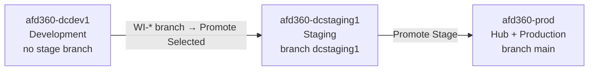

# data360-lifecycle-center-devops

How to move a **Data 360 (Data Cloud) data kit** from a dev sandbox through staging to production
with **Salesforce Lifecycle Center** (formerly DevOps Center), and what you still do by hand in each
org. This was tested end to end on Winter '27 (264.7.5) in October 2026.

**▶ Walkthrough deck: <https://congmingwudi.github.io/data360-lifecycle-center-devops/>**
(one page, works offline; use ← → to move between slides).

This repo has:

- an ordered **runbook** in [`plan/`](plan/), with a "done when" check and screenshots for each step,
- reusable bash **scripts** in [`scripts/`](scripts/README.md) for every step that can be automated,
- the **sample data** ([`data/branch-offices-seed.csv`](data/branch-offices-seed.csv)) and the
  resulting **kit metadata** ([`examples/`](examples/README.md)) for the test config. The fully
  built-out data kit, as a standalone SFDX project you can deploy with the `sf` CLI, is in
  [`sf-d360-branches-datakit`](https://github.com/congmingwudi/sf-d360-branches-datakit).

## The test config in one line

> One file-upload (CSV) data stream → DLO → mapped to a custom DMO, wrapped in a **DevOps** data kit,
> promoted through a `Development → Staging → Production` Lifecycle Center pipeline.

## What to know before you start

Two findings, both verified in Staging and Production ([`plan/30-promote.md`](plan/30-promote.md) §7):

1. **DX Inspector can't commit a data kit.** Every component stages, then the commit fails at
   finalize with *Commit failed during processing*. Commit the kit with
   [`scripts/commit-datakit-to-work-item.sh`](scripts/commit-datakit-to-work-item.sh) instead.
   Lifecycle Center then inspects, reviews and promotes it like any other change.
2. **A promotion only installs the kit.** It's a Metadata API deploy of the definition and
   templates, and it creates nothing that runs. In each target org you then:
   - make sure the **data space** exists (`default` here, so nothing to create),
   - **activate** the file connection *if it's inactive*,
   - run [`scripts/deploy-datakit-components.sh`](scripts/deploy-datakit-components.sh), which
     creates the streams, DLOs, mappings and insights,
   - the first time, **Update File** on the stream (upload the CSV) to activate it, and
   - run any new calculated insight once
     ([`scripts/create-calculated-insight.sh`](scripts/create-calculated-insight.sh) `--run-only`).

Use a **DevOps** data kit, not Standard. Only a DevOps kit can be built in a sandbox and moved by
the Metadata API, CLI or change sets ([`plan/references.md`](plan/references.md)).

## Orgs

The docs name three orgs by their `sf` CLI alias. Log in to your own orgs under these aliases, or
substitute yours in the commands ([`plan/orgs.md`](plan/orgs.md)).

| Role                                              | Alias               | Type       |
|---------------------------------------------------|---------------------|------------|
| Lifecycle Center **Hub** + **Production** stage   | `afd360-prod`       | production |
| **Development** environment                       | `afd360-dcdev1`     | sandbox    |
| **Staging** (middle stage)                        | `afd360-dcstaging1` | sandbox    |

The Hub lives in production because a sandbox refresh would wipe the Lifecycle Center and Data
Cloud state. Here the same org is also the final Production stage.

## Pipeline



Branches map right to left: the **last stage (Production) owns `main`**, and Staging gets an
intermediate branch (`dcstaging1`, cut from `main`). A work item moved to *In Progress* gets a
`WI-00000N` branch cut from `dcstaging1`. The work-item lifecycle is **New → In Progress →
In Review → Ready to Promote → Promoted → Closed**.

More diagrams: [`plan/architecture.md`](plan/architecture.md).

## Runbook (follow in order)

1. [`plan/00-prereqs.md`](plan/00-prereqs.md): Hub enablement, permission sets, GitHub, Data Cloud
   in the sandboxes, the data space.
2. [`plan/10-lifecycle-center-setup.md`](plan/10-lifecycle-center-setup.md): create your pipeline repo,
   connect GitHub and the environments, shape the pipeline, create the project.
3. [`plan/20-build-data-kit.md`](plan/20-build-data-kit.md): build the CSV stream → DLO → DMO and
   package the data kit in the dev sandbox.
4. [`plan/30-promote.md`](plan/30-promote.md): work item, commit the kit with the script, review,
   promote to Staging and Production, and the post-install steps in each target. Start with its
   *verified process at a glance*.
5. [`plan/40-mcp-optional.md`](plan/40-mcp-optional.md): optional, script the lifecycle with the
   Salesforce DX MCP Server.
6. [`plan/50-cap-governance.md`](plan/50-cap-governance.md): optional, add governance once AI
   coding agents drive the pipeline.

References (not steps): [`plan/orgs.md`](plan/orgs.md) (aliases),
[`plan/references.md`](plan/references.md) (official Salesforce sources, with read dates),
[`plan/architecture.md`](plan/architecture.md) (diagrams).

## Using this repo for your own pipeline

Lifecycle Center **owns its pipeline's repo**: the branches *are* the stages, and it creates,
commits and merges for you. Give it a repo of its own:

1. **Use this template → Create a new repository** on GitHub (private is fine).
2. Connect *that* repo to your pipeline ([`plan/10`](plan/10-lifecycle-center-setup.md) §1, §3).
3. Let Lifecycle Center and the commit script be the only writers of `force-app/`. Commit only docs,
   scripts and config by hand.

`force-app/main/default/` starts empty on purpose. Kit source lands there only on `WI-*` branches,
written by the commit script, and reaches the stage branches by promotion. `sfdx-project.json` is
at API 64.0 because the kit's `DataPackageKitDefinition` won't deploy at 62.0.

## Scripts

They take org aliases as flags, are safe to re-run and check their own result. The four kit scripts
(commit, CLI deploy, component deploy, calculated insight) have a `--dry-run`. Each needs the `sf` CLI, `jq`, `git` and bash. Full list: [`scripts/README.md`](scripts/README.md).

```bash
./scripts/setup-devops-center-hub.sh --target-org afd360-prod
./scripts/verify-datacloud-prereqs.sh -o afd360-dcdev1 -o afd360-dcstaging1 -o afd360-prod
./scripts/commit-datakit-to-work-item.sh -k branch_offices_datakit -s afd360-dcdev1 --hub afd360-prod -w WI-00000N --validate-org afd360-dcstaging1 --dry-run
./scripts/deploy-datakit-components.sh -k branch_offices_datakit -o afd360-dcstaging1 --dry-run
./scripts/create-calculated-insight.sh -o afd360-dcstaging1 --run-only
```

## Disclaimer

This is a tested example, not an official Salesforce tool or product documentation, and it's
provided as is. Lifecycle Center and Data 360 change from release to release, so check the sources
in [`plan/references.md`](plan/references.md) for your release. Run the scripts with `--dry-run`
first, and against sandboxes before production.
