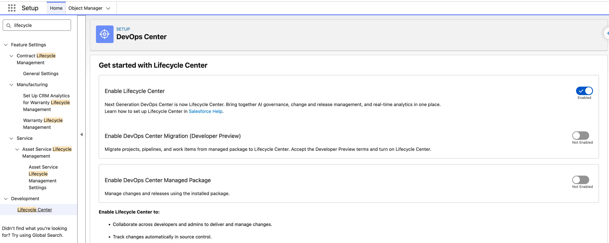
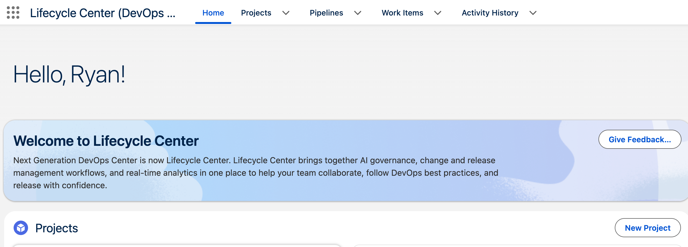

# 00 — Prerequisites

> **Orgs:** aliases like `afd360-prod` / `afd360-dcdev1` / `afd360-dcstaging1` are defined in
> [`orgs.md`](orgs.md).
>
> **Sources:** official Data 360 docs on kits, sandboxes, and deployment are indexed in
> [`references.md`](references.md). Start with
> [Build and Share Data 360 Functionality](https://help.salesforce.com/s/articleView?id=data.c360_a_build_and_share_functionality.htm&type=5)
> and the Trailhead module [Data 360 Sandboxes](https://trailhead.salesforce.com/content/learn/modules/data-360-sandboxes).

Do these before touching Lifecycle Center. Ordered; each has a "done when" check.

## 1. Confirm the Hub org

- **Hub = `afd360-prod`** (durable production home org).
- Lifecycle Center (formerly Next-Gen DevOps Center) is **enabled by default** — no managed package
  to install. To confirm, open **Setup → Lifecycle Center** (Quick Find "lifecycle"; the page header
  still reads *DevOps Center*): **Enable Lifecycle Center** is on. Leave *DevOps Center Migration*
  and *DevOps Center Managed Package* off; they're for orgs moving from the old managed package.

- Open **App Launcher → Lifecycle Center** once (listed as *Lifecycle Center (DevOps Center)*). A DX
  Tools terms & conditions prompt *may* appear on first open — accept it if it does. If no prompt
  appears, it was already accepted at provisioning (common); that's fine. The T&C can also surface
  later at the first **Connect to Version Control** step — accept it there instead.
- **Done when:** the Lifecycle Center app opens in `afd360-prod` under a **Welcome to Lifecycle
  Center** banner, with the **Home / Projects / Pipelines / Work Items / Activity History** tabs live
  (not greyed out).

In a new Hub the **Projects** list is empty, and until you connect GitHub (`10 §2`) Home also shows a
**Connect to Version Control** card. That's the expected empty state.

> **Naming:** in Winter '27, **DevOps Center was renamed Lifecycle Center**. The permission-set
> labels changed too, but API names didn't (`DevOpsCenterManager`, `DevopsRequestInfo`, …), so the
> scripts and SOQL work either way. Screenshots in `10`–`30` taken before the rename still show
> "DevOps Center".

## 2. Permission sets (in the Hub org)

Assign to yourself (the admin/operator):

- `Lifecycle Center Admin` (API `DevOpsCenterManager`; "DevOps Center Admin" before Winter '27)
- `Lifecycle Center User` (API `DevOpsCenter`)
- `Lifecycle Center Deployment Manager` (API `DevOpsCenterReleaseManager`)

Or run `./scripts/setup-devops-center-hub.sh --target-org afd360-prod`, which assigns and verifies all three.

> Users driving the pipeline need a Salesforce license + a Standard User profile (or equivalent) plus these permission sets.

- **Done when:** the Lifecycle Center app tabs (Projects, Pipelines, Work Items) are all visible and not greyed out.

## 3. Source control account

- A **GitHub** account (Bitbucket also works) that can create/own a repo.
- You will authorize Lifecycle Center to this account via OAuth in `10-lifecycle-center-setup.md`.
- **Done when:** you can log into GitHub and create repos.

## 3b. Local tools

- The **Salesforce CLI** (`sf`), authenticated to every org with the aliases in [`orgs.md`](orgs.md)
  (`sf org login web --alias afd360-dcdev1 --instance-url https://test.salesforce.com`, and so on).
- **`jq`**, **`git`** with push access to the pipeline repo, and **bash**. The `scripts/` need all
  of them.
- **Done when:** `sf org list` shows all three aliases as Connected, and `jq --version` works.

## 4. Data Cloud provisioned in BOTH sandboxes

Data Cloud sandboxes are GA but **not automatic**. For **each** of `dcdev1` and `dcstaging1`:

1. Ensure **Data Cloud sandbox credits** are provisioned from the prod home org.
2. In the sandbox: **Setup → Data Cloud → Get Started** (manual provisioning step).
3. Remember: a sandbox gets **metadata config, not data**. Source connections can come over **inactive**; activate them in the target (`30 §6` step 2). A **sandbox refresh resets the Data Cloud tenant** — you'd re-provision.

> **Prod already has Data Cloud.** Data Cloud in a sandbox is only available because it's provisioned
> in the prod home org first — prod Data Cloud is the *parent prerequisite*. So if the sandboxes have
> it, `afd360-prod` has it too. That matters because `afd360-prod` is also the pipeline's **Production
> stage** (`10 §3b`): the tenant is in place, though the runtime wiring (`30 §6`) is still redone
> there on promotion.

- **Done when:** Data Cloud Home loads in both `dcdev1` and `dcstaging1`, and Data Cloud Setup nodes (Data Streams, Data Lake Objects, Data Model, Data Kits) are present.

## 5. Pre-create the Data Space in the target (dcstaging1)

- A data kit **references** its data space by name (`dataSpaceDefinitionDevName` on
  `DataPackageKitDefinition`, API v61.0+) — but there is **no standalone deployable data-space
  metadata type**, so a data space doesn't materialize on its own from a deploy. A DevOps kit deploys
  its components into the **same-named data space in the target, which must already exist there.**
- In `dcstaging1`: confirm the **same-named data space** you build in `dcdev1` already exists. Building
  in **`default`** means there's nothing to pre-create; only a **custom** space needs creating in the
  target first.
- **Done when:** `dcstaging1` has a data space whose name matches the one used in `dcdev1`.

> **Verified 2026-09-28 (afd360 orgs):** all three orgs run **API v67.0**; the Metadata API exposes the
> data-kit types (`DataPackageKitDefinition`, `DataPackageKitObject`, `DataStreamDefinition`, …) but
> **no `DataSpace` type**; `default` exists and is **ACTIVE** in `dcdev1`, `dcstaging1`, and
> `afd360-prod`. This is why the runbook builds in `default` — it's the version-independent path that
> binds on promotion without pre-creating a space. (Current Salesforce docs say custom/default data
> spaces are "packageable" in DevOps kits, but with the caveat that the kit deploys to the *same*
> space in the target — consistent with the target space needing to exist. Sources:
> [metadata cheat sheet](https://developer.salesforce.com/docs/data/data-cloud-dev/guide/component-cheatsheet.html),
> [ISV/DevOps readiness matrix](https://developer.salesforce.com/docs/data/data-cloud-ref/guide/c360a-api-isv-readiness-data.htm),
> [`DataPackageKitDefinition`](https://developer.salesforce.com/docs/atlas.en-us.api_meta.meta/api_meta/meta_datapackagekitdefinition.htm).)
>
> **Two-experiment plan:** experiment 1 (this runbook) progresses a kit through the pipeline in the
> **`default`** space — proving the end-to-end flow with nothing to pre-create. A **second** project
> will build in a **new custom data space** to empirically settle whether a custom space is carried by
> a DevOps kit or must be pre-created in the target. Until that runs, treat custom-space packageability
> as **unverified here** and pre-create the space to be safe.

---

**Why so much manual Data Cloud setup?** Lifecycle Center promotes (installs) the data-kit *definition* cleanly, but Data Cloud's runtime wiring (the data space, connection activation, the component deploy, the file upload) is environment-specific and only partly captured as metadata today. Knowing this up front is what keeps the promotion in `30-promote.md` from looking "broken" when it's actually working as designed.
