# 10 — Lifecycle Center setup (repo, environments, pipeline)

Prereq: `00-prereqs.md` complete. All UI steps below are in the **Hub org (`afd360-prod`)** unless stated.

> **Orgs:** the `afd360-*` aliases used here are defined in [`orgs.md`](orgs.md).

## 1. Create your pipeline repo on GitHub

Lifecycle Center needs **its own** repo, one per pipeline, because it owns the branches. Don't connect
it to the public repo this runbook lives in. Make your own copy: on GitHub, **Use this template →
Create a new repository** (private is fine), then clone it and confirm it's in sync:

```bash
git clone https://github.com/<your-github-org>/<your-pipeline-repo>.git
cd <your-pipeline-repo>
git remote -v          # origin -> https://github.com/<your-github-org>/<your-pipeline-repo>.git
git log --oneline -1   # HEAD matches origin/main (push first if it doesn't)
```

The copy brings the SFDX project (`sfdx-project.json`, an empty `force-app/`, `.forceignore`), the
scripts and these docs. [`examples/`](../examples/README.md) is reference only and isn't a package
directory, so Lifecycle Center ignores it.

> We connect an **existing** repo (rather than letting Lifecycle Center create one) so the SFDX
> project layout + `.forceignore` are exactly what we scaffolded. From here on, Lifecycle Center owns the
> branches and every merge into `dcstaging1` and `main` (see README, "Why a dedicated repo"). The only
> other writer is `scripts/commit-datakit-to-work-item.sh`, which pushes a data kit's source to a `WI-*`
> branch (`30 §3e`) because DX Inspector's commit fails for kits. Nothing commits to `main` or
> `dcstaging1` directly except plan, script and config files.

## 2. Connect GitHub to Lifecycle Center

This step authorizes Lifecycle Center to your GitHub **account**. You pick the specific repo later,
when you create the Project (§3).

- From the Lifecycle Center **Home**, use the **Connect to Version Control** card → **Connect**
  (the card is on the right). Choose **GitHub** →
  **Authorize**.
- On GitHub's **Authorize Salesforce DX** screen, approve access for your account
  (public + private repos). You do **not** need to "Grant" any GitHub org you happen to belong
  to — the target repo lives under your personal account.
- If a **DX Tools terms & conditions** prompt appears here (it may not have on first app open),
  accept it now.

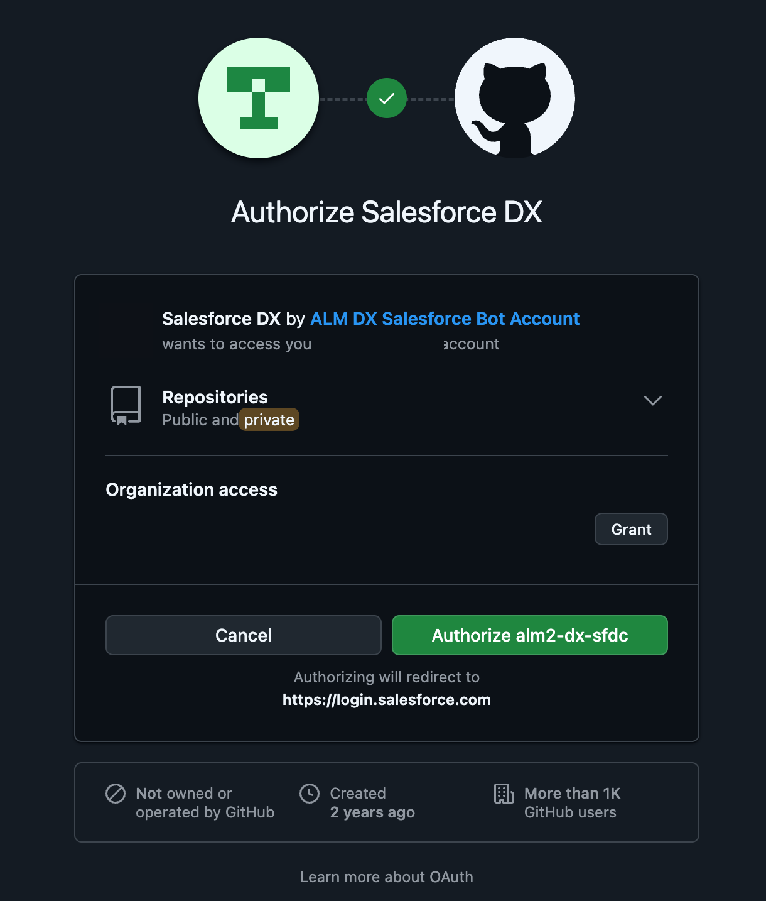

- **Done when:** the Home card reads **"Connected as `<your-github-user>`"** in place of the
  Connect button.

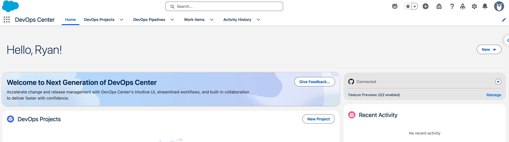

> **Pipeline and Project are separate objects, linked either direction — order is your choice.** The
> pipeline's create wizard has a *"Connect pipeline to projects"* step, and the project's create form
> has a *"Pipeline"* picker — the same link, made from whichever side you build second. This runbook
> does **pipeline first** (§3 → §4) because the pipeline carries all the real setup (repo, stages,
> branch); creating the project afterward is then just "name it + pick the pipeline." If you build the
> project first instead, its Pipeline picker is simply empty until the pipeline exists, and you link
> them from the pipeline wizard's project step.

## 3. Build the pipeline

The pipeline is where the **repo** binds and where the stage → environment → branch wiring lives.
Create it on the **Pipelines** tab; it's a short wizard, then an on-page stage editor.

### 3a. New Pipeline wizard

1. Lifecycle Center → **Pipelines → New**.
2. **Pipeline Name:** `dc-data-kit-experiment-pipeline`. **Source Control System:** `GitHub`. Choose
   **Connect to a repository** (not *Create a repository* — the repo already exists) and paste the
   **Repository URL** `https://github.com/<your-github-org>/<your-pipeline-repo>`. → **Next**.

   > A Lifecycle Center pipeline "must use the Salesforce DX project structure and connect to a **unique**
   > version-control repository" — i.e. one repo per pipeline. This is where the repo binds; the
   > project (§4) has no repo field.

   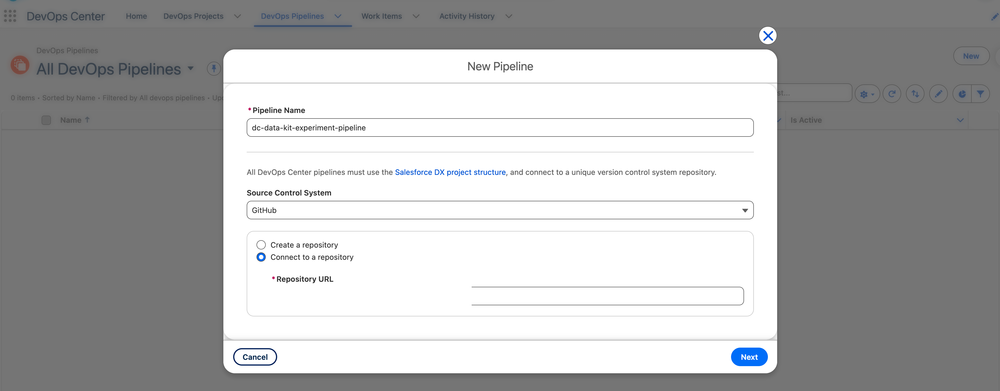

3. **Connect pipeline to projects:** this lists only projects not already on a pipeline. Doing
   pipeline-first, it's **empty** — that's expected; leave it and click **Create Pipeline**. (You
   link the project from its own form in §4.)

   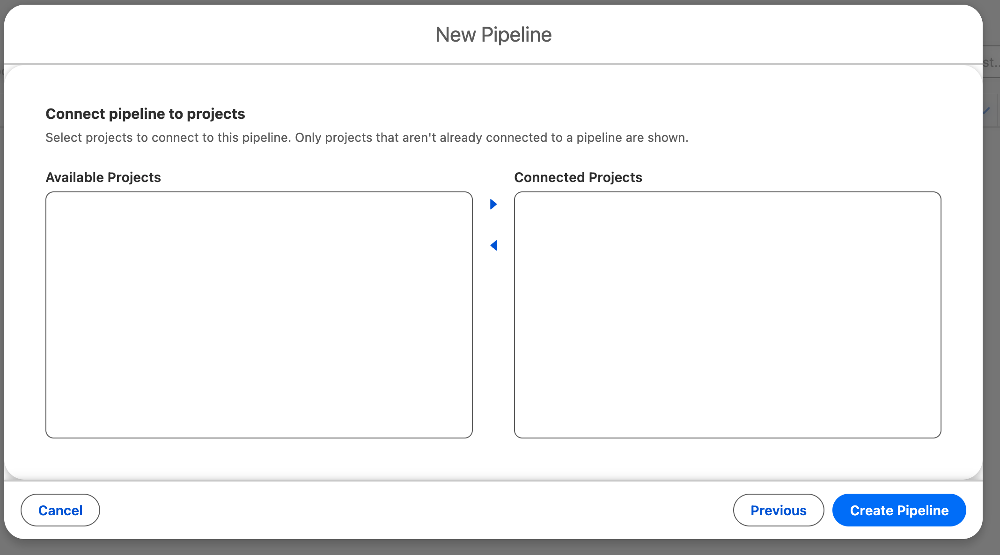

### 3b. Configure the stages (Development → Staging → Production)

The new pipeline opens on the **Pipeline Stages** editor with default promotion stages
**Integration → UAT → Staging** and a separate **Development Environments** box on the left. Note the
header shows **Repository** bound and **Activate Pipeline** greyed until setup is finished. Target:

| Pipeline stage / slot        | Environment         | Type           | Branch               |
|------------------------------|---------------------|----------------|----------------------|
| Development Environments     | `afd360-dcdev1`     | Sandbox        | *(none)*             |
| Staging (promotion stage)    | `afd360-dcstaging1` | Sandbox        | `dcstaging1` (intermediate)     |
| Production (promotion stage) | `afd360-prod`       | Production Org | `main`               |

> **Branch mapping is right-to-left: the *last* stage owns `main`.** With Production as the final
> stage, **`main` deploys to `afd360-prod`** — Staging gets its own intermediate branch. (This is a
> shift from a 2-stage pipeline, where Staging would own `main`.) `afd360-prod` here is the same org
> as the Lifecycle Center **Hub** — it is both the control plane and the Production release target.

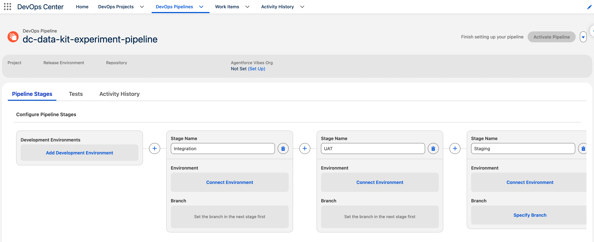

Steps:
1. **Add Development Environment** (left box). In the **Add Environment** dialog, set **Environment
   Name** to `afd360-dcdev1` and click **Connect** — this opens the Salesforce login window.

   

   Log in to the **dev sandbox** (at `test.salesforce.com`; the sandbox username is your prod
   username with the sandbox suffix, e.g. `<your-username>.dcdev1`), then **Allow** the
   `ALMDevOpsConnectedApp` OAuth consent. Development is an *environment slot*, not a promotion stage,
   so it has **no branch**.

   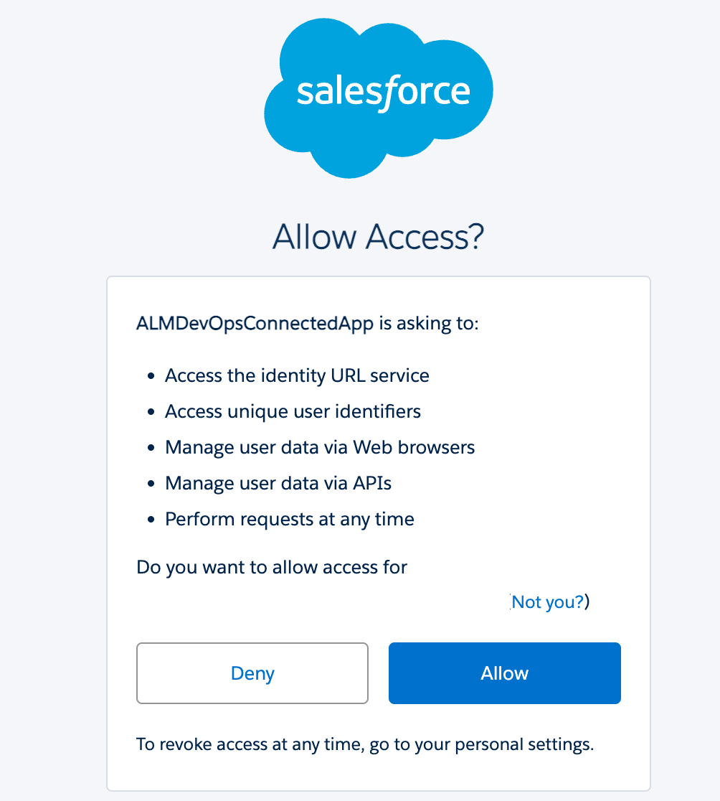
2. **Shape the promotion stages to `Staging → Production`.** Delete the default stages you don't want
   with the trash-can icon (e.g. `Integration`, `UAT`) and use the **`+`** between stages to add one
   named `Production` after `Staging`. End state: two promotion stages, `Staging` then `Production`.

   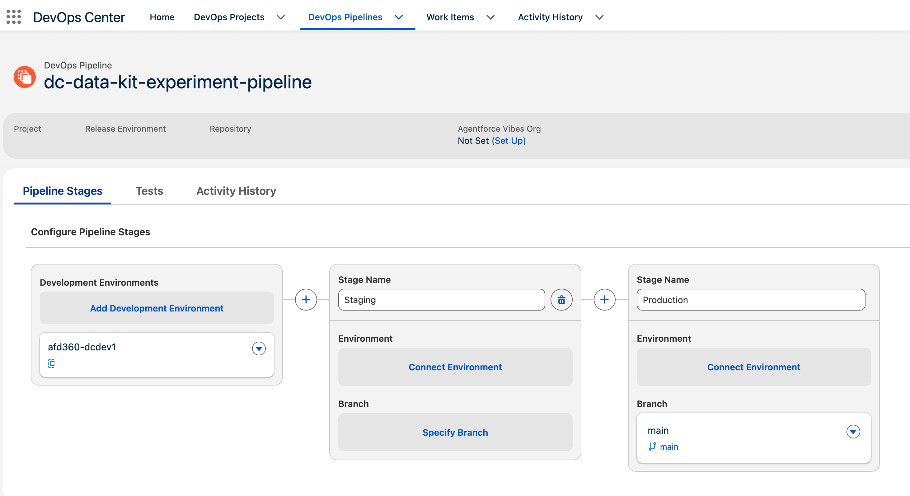
3. **Connect the `Staging` stage** → **Connect Environment**, **Environment Name** `afd360-dcstaging1`,
   **Environment Type = Sandbox**, **Connect**, then OAuth-approve in the staging sandbox.

   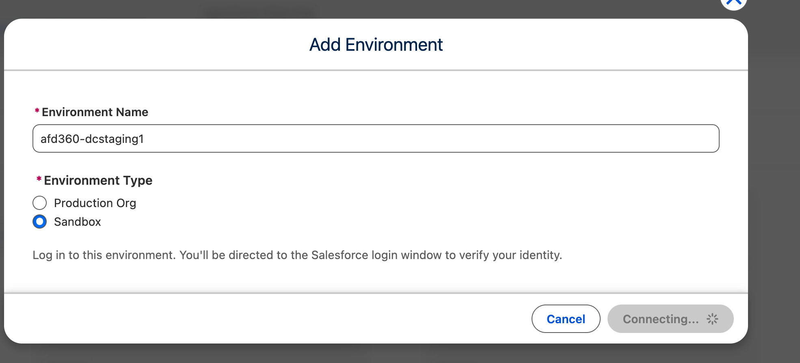
   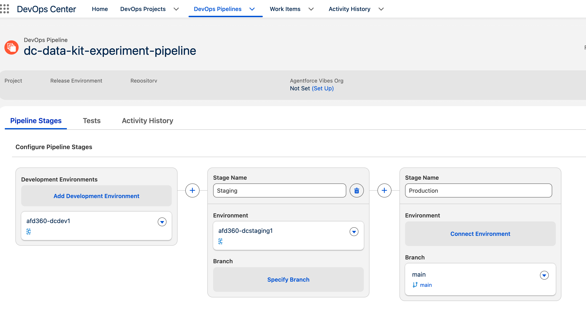
4. **Connect the `Production` stage** → **Connect Environment**, **Environment Name** `afd360-prod`,
   **Environment Type = Production Org**, **Connect**, then OAuth-approve in the prod org.

   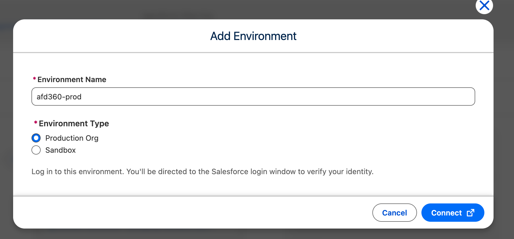
5. **Branches:** `Production` (last stage) is bound to **`main`**. **Specify Branch** on `Staging` —
   in the **Add Branch** dialog leave **"Create a branch from main for this stage"** selected and enter
   the Branch Name **`dcstaging1`**, then **Save**. (Any unique name works; this project matched the
   branch to the staging org's short name. Because it's cut from `main`, this is the concrete form of
   the right-to-left rule above.) The pipeline can't activate until every promotion stage has a branch.

   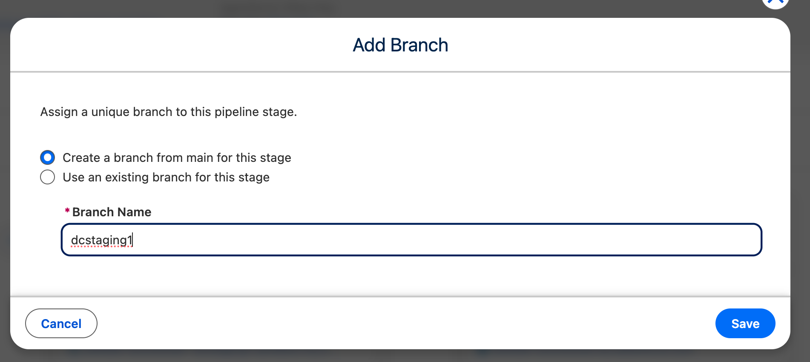
6. **Activate the pipeline.** Once every stage carries an environment **and** a branch, the header
   status flips to **Ready** and **Activate Pipeline** (top-right) lights up (the editor stops nagging
   "Finish setting up your pipeline"). Click **Activate Pipeline**.

   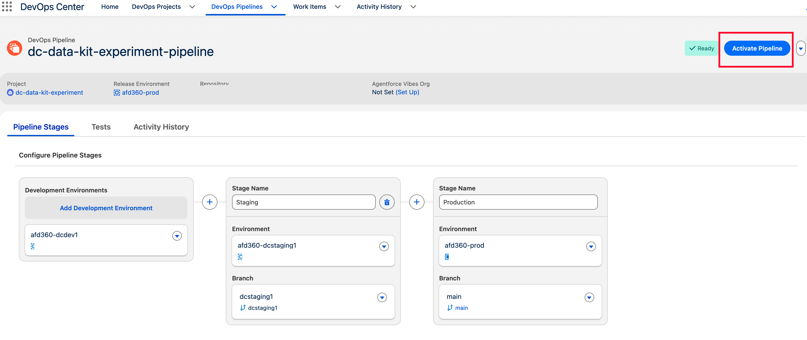

   Activation is what makes the pipeline real: Lifecycle Center **cuts the pending `dcstaging1` branch from
   `main` on GitHub** (until now it exists only as a pipeline *declaration*, not an actual Git branch),
   and the page flips from the stage **editor** to the runtime **promotion board** — columns for
   Approved Work Items → Staging → Production, each with a (greyed until there's a work item) **Promote
   Stage** control.

   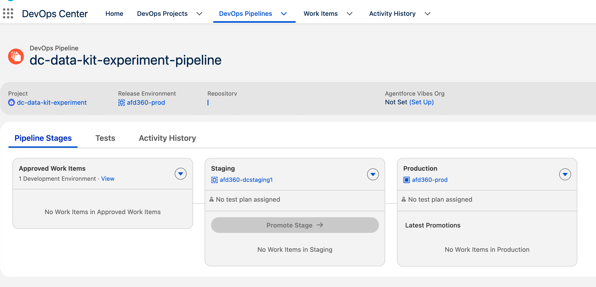

   > **Don't skip this — an inactive pipeline breaks the work-item flow.** If the pipeline is left
   > un-activated, `dcstaging1` is never created on GitHub, so moving a work item to **In Progress**
   > (`30 §2`) — which cuts the feature branch `WI-00000X` off the Staging branch — fails with a bare **"An
   > unexpected error occurred."** The tell (queryable in the Hub org): `DevopsPipeline.IsActive` is
   > `false` and the Staging branch is still a pending `$$dcstaging1` record. Activating here is what
   > prevents that.

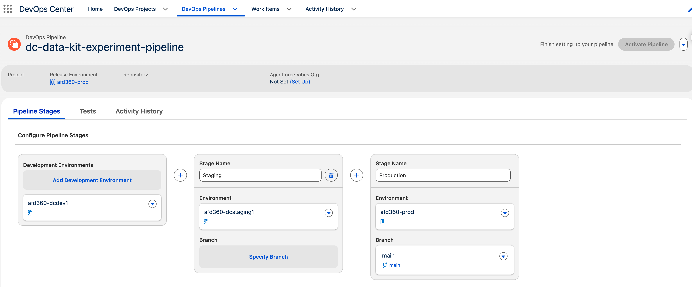

- **Done when:** the pipeline shows `afd360-dcdev1` (Development) → `afd360-dcstaging1` (Staging) →
  `afd360-prod` (Production, branch `main`), all environments **Connected**, and the pipeline **Active**.

> **Heads-up for promotion (see `30`):** promoting all the way to Production deploys the data kit into
> `afd360-prod`. Data Cloud is **already provisioned there** — it's the parent prerequisite for Data
> Cloud in the sandboxes, so if the sandboxes have it, prod does too. You still redo the runtime
> wiring (confirm the `default` data space, activate the UploadedFiles connection only if it is
> inactive, run `scripts/deploy-datakit-components.sh`, upload the CSV once with Update File, and run
> any new calculated insight; see `30 §6`) in prod, just as in any target. If you
> only intend to exercise dev → staging for now, just don't promote past the Staging stage.

## 4. Create the Project (against the pipeline)

- Lifecycle Center → **Projects → New**.
- The **New Project** window (*New DevOps Center Project* before the rename) has three fields: **Project Name** (required),
  **Description** (optional), and a **Pipeline** picker. The picker lists existing pipelines only;
  there is **no repo field here** — the GitHub repo binds at the pipeline (§3), not the project.
- Name: `dc-data-kit-experiment` (kept generic — not tied to any org). Description is optional
  (e.g. *"Project to demonstrate progressing a Data Cloud Data Kit through a DevOps Pipeline"*).
- **Pipeline:** select `dc-data-kit-experiment-pipeline` (built in §3), then **Save**. Work items you
  create later run against this project.


- **Done when:** the project detail page opens showing the attached **Pipeline**
  (`dc-data-kit-experiment-pipeline`), **Release Environment** `afd360-prod`, and the bound
  **Repository** — with no work items yet.


## 5. The dev environment's change-tracking surface (DX Inspector)

- The in-org surface for tracking and committing changes is **DX Inspector**. It's **available by
  default** — nothing to install — and appears at the top of any page or builder in the connected dev
  sandbox (`afd360-dcdev1`), linking that org to your Lifecycle Center project. Its **Change Management**
  tab shows all source-tracked changes; from there you create the work item, commit metadata to the
  project repo, and open the change request (pull request) without leaving the org. (Salesforce Help:
  [DX Inspector](https://help.salesforce.com/s/articleView?id=platform.devops_center_dx_inspector.htm&type=5),
  [Next-Generation DevOps Center (now Lifecycle Center)](https://help.salesforce.com/s/articleView?id=platform.next_generation_devops_center.htm&type=5).)
- **Done when:** `afd360-dcdev1` shows as a **Connected** Development environment on the pipeline (§3b)
  and DX Inspector is visible in that org — you're ready to build the data kit. The commit itself is `30 §3`.

> **To explore after experiment 1 (not needed for it):** DX Inspector also offers **Add Metadata
> Manually** (include files source tracking didn't auto-pull), change requests with auto-run tests, and
> **Data Commit and Deployment** — *"move configuration data between environments using the same commit
> and deploy flow that you use for metadata."* The Help article makes **no Data Cloud / data-kit
> mention**, so whether that data-commit path can carry any of the Data Cloud runtime wiring we
> otherwise redo by hand (`30 §6`) is an **open question** worth testing once the experiment-1 baseline
> is done. Keep DX Inspector in this project's docs only if it proves useful for Data Cloud.

---

Next: build the data kit in `afd360-dcdev1` → `20-build-data-kit.md`.
