# 20 — Build the data kit (in dcdev1)

Goal: a **file-upload (CSV) data stream → DLO → mapped to a DMO**, packaged as a **Data Kit**.
All steps are in **`dcdev1`** (the Development environment).

> **Orgs:** `dcdev1` / `dcstaging1` (full aliases `afd360-dcdev1` / `afd360-dcstaging1`) are defined
> in [`orgs.md`](orgs.md).

## 1. Prepare a tiny CSV

Keep it small and obvious so mapping is trivial. We deliberately use **reference/catalog data
(branch offices), not person data** — so the DLO maps to a **custom DMO** and can never bind to a
customer's standard Individual/Account party graph. Committed as
[`data/branch-offices-seed.csv`](../data/branch-offices-seed.csv):

50 branch offices spread across the US and Europe (first rows shown):

```csv
OfficeCode,OfficeName,Region,State,Country,OpenedDate
BR-001,Downtown Branch,West,CA,US,2019-04-01
BR-002,Riverside Branch,Midwest,IL,US,2021-09-15
BR-026,Thames Branch,Western Europe,England,United Kingdom,2016-03-15
BR-030,Seine Branch,Western Europe,Ile-de-France,France,2015-09-19
```

## 2. Create the file-upload data stream

> **Sandbox prerequisite:** the **UploadedFiles** connection (connection type **File Upload**) must be
> **activated** before it can be used to create a data stream. In a sandbox it arrives inactive —
> activate it under **Data Cloud Setup → Other Connectors** first, or **File Upload** won't appear as a
> source option below. (The same gotcha applies in a promoted target only if the connection is inactive there: it was in
> `dcstaging1`, not in `afd360-prod`. See `30-promote.md §6` step 2.)
>
> 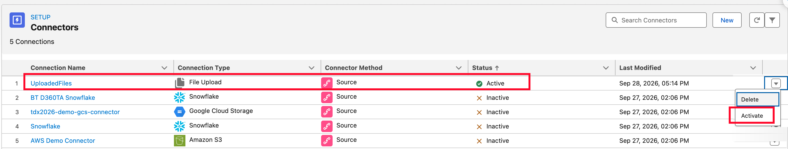

- Data Cloud → **Data Streams → New**, then under **Other Sources** pick **File Upload** (CSV).

  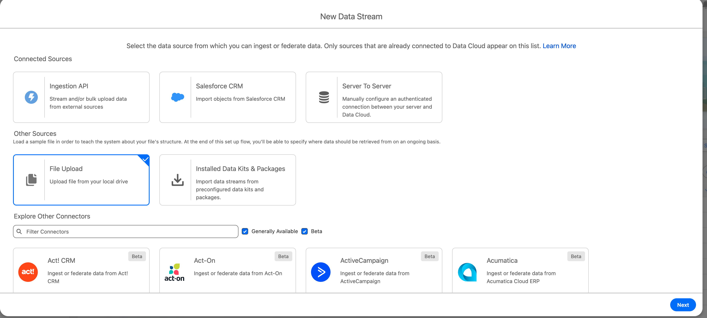
- Upload [`data/branch-offices-seed.csv`](../data/branch-offices-seed.csv). Set **Category** to **Other** (not Profile — this is reference data, not party data), the **primary key** to `OfficeCode`, and an **event/record datetime** to `OpenedDate` if prompted (the **Record Modified Field** is optional and can be left unset).

  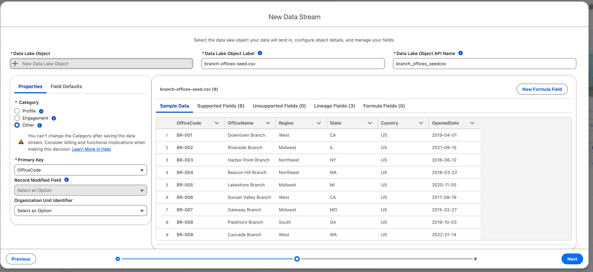
- Choose the **data space** you pre-created (must match `dcstaging1` — see `00-prereqs.md §5`). We build in **`default`**.

  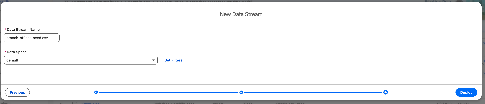
- Deploy the stream. This creates a **Data Lake Object (DLO)**, here `branch_offices_seedcsv__dll`, and runs the first ingest.
- **Done when:** the stream shows **Active** with all 50 rows processed. (Data Mapping still reads **0/0** at this point — that's §3.)

  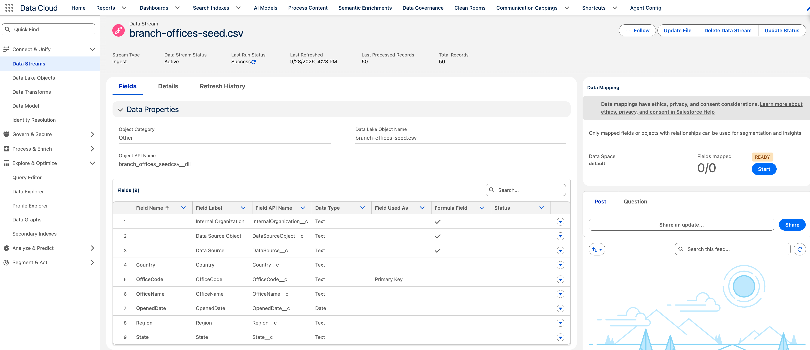

## 3. Map the DLO to a DMO

- From the deployed data stream, open **Data Mapping → Start**. In **Select Objects**, choose the **Custom Data Model** tab → **New Custom Object** (do **not** map to a standard party DMO under Standard Data Model — Individual / Account / Contact Point — a custom DMO keeps this experiment isolated from any real Customer 360 data in the target).

  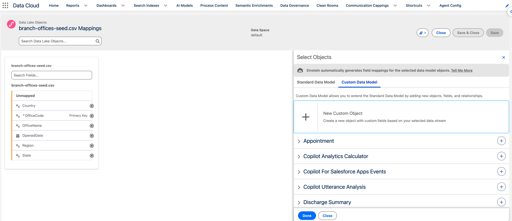
- Define the custom DMO **`Branch Office`** (API name `Branch_Office`, Category **Other**) and keep the mapped fields (office code, name, region, state, country, opened date). `OfficeCode` carries the **Primary Key**.

  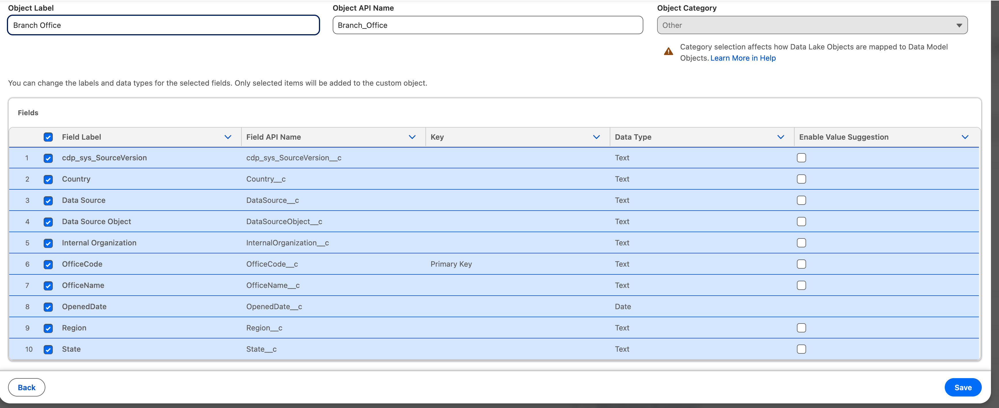
- Confirm the DLO fields resolve to the DMO: all six source fields map to `Branch Office`, `OfficeCode → OfficeCode` as the key. Save.

  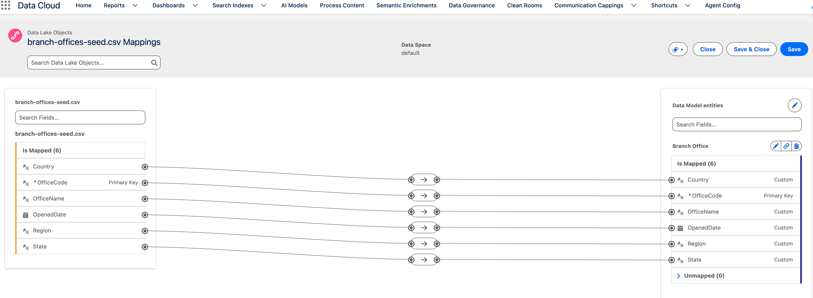
- **Done when:** the stream's **Data Mapping** panel reads **11/11 → READY**, and **Data Explorer** (Data Model Object → `Branch Office`, data space `default`) previews the branch-office rows.

  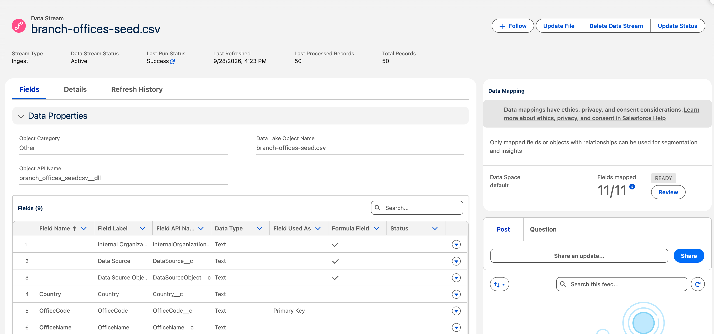

  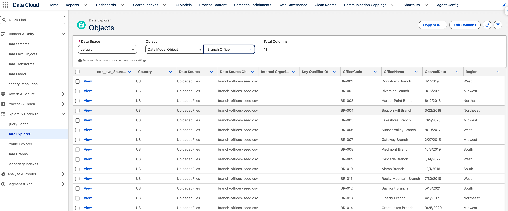

## 4. Package it as a Data Kit

- **Data Cloud Setup → Data Kits → New.** Set **Data Kit Type = DevOps** (the metadata-deploy path this
  pipeline uses — *not* "Standard", which ships as an installable package), **Data Space = `default`**,
  Name `branch offices datakit` (API `branch_offices_datakit`). Keep the name generic — not tied to any org.

  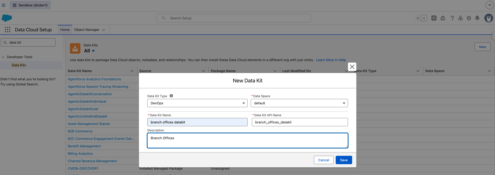

  > **DevOps is the right type for a pipeline Lifecycle Center manages.** Lifecycle Center moves a
  > kit as metadata through its stages. Only a DevOps kit:
  > - can be built in a sandbox like `dcdev1` (Standard kits require a Developer Edition org);
  > - moves by Metadata API, CLI, or change set (Standard kits move only as a package);
  > - carries its connector information to each target;
  > - deploys its components with nothing but the kit name.
  >
  > You can't switch an object to the other type later. The full comparison, with sources, is in
  > [`references.md` → DevOps vs. Standard](references.md#devops-vs-standard-data-kits-compiled-2026-10-27).
  > Either type still needs a separate **component deploy** in the target after install
  > (`30-promote.md` §6 step 3).
- The kit is created empty and flags **"Publishing sequence not defined"** — you clear that at the end.

  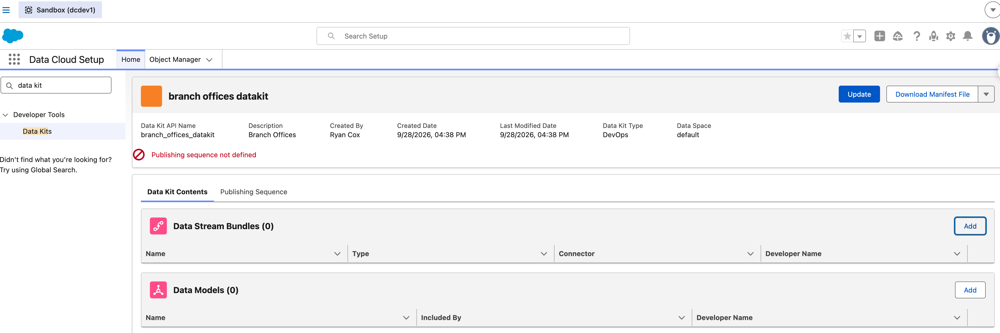
- **Add the data stream bundle:** Data Stream Bundles → **Add** → Connector Type **File Upload**, Bundle
  Name `branch_offices_bundle`, and select the `branch-offices-seed.csv` stream.

  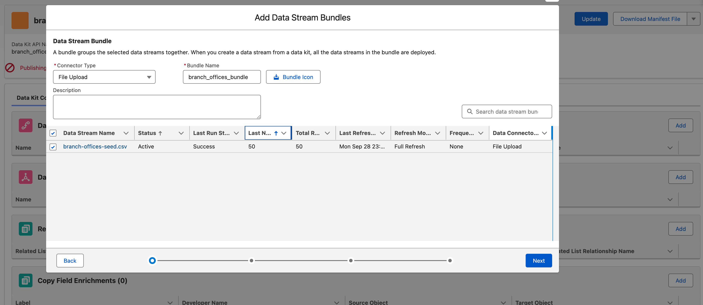
- **Add related objects:** the wizard pulls in the **UploadedFiles connection** and the **`Branch Office`
  data model** (Custom). Note the warning — *connector metadata only updates in the target if no active
  connector with the same API name already exists* — which is exactly why the connection is re-wired by
  hand in the target when it is inactive (`30 §6` step 2).

  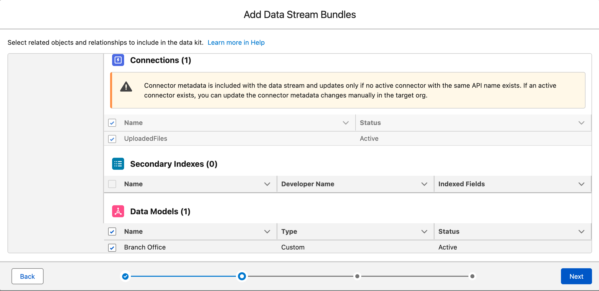
- Click through **Policy Rule Definitions** and **Tags** (none here) and **Save**.

  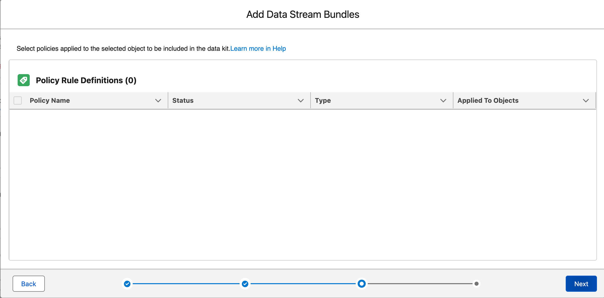
  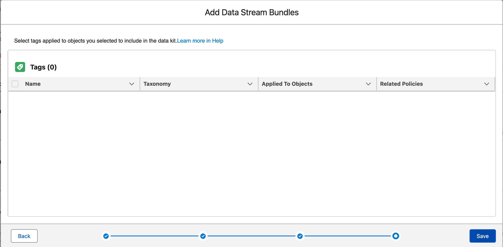
- **Verify contents:** the kit now lists **Data Stream Bundles (1)** (`branch_offices_bundle` → item
  `branch-offices-seed.csv`), **Data Models (1)** (`Branch Office` / `Branch_Office__dlm`), and
  **Connections (1)** (`UploadedFiles`).

  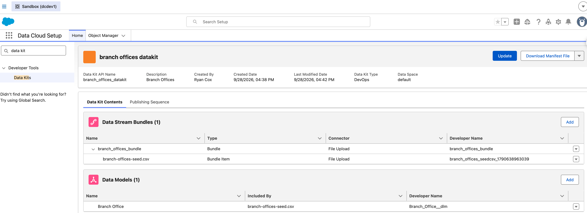
  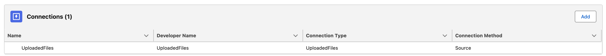
- **Check the publishing sequence** — the DevOps-kit analogue of "publish". On the **Publishing
  Sequence** tab, the **default order is already correct**: `1` `UploadedFiles` (Connection) →
  `2` `branch_offices_bundle` (Data Stream Bundle), i.e. dependencies first. This is the kit's
  `deploymentOrder`, which the target replays on deploy (`30 §5`). You can open **Edit Sequence** to
  confirm/reorder, but it isn't required here since the default is right.

  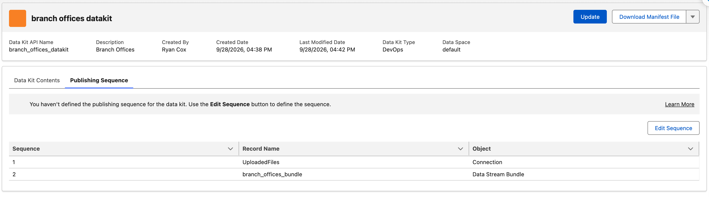

  > **Verified quirk (2026-09-28):** the banner **"You haven't defined the publishing sequence…"
  > persists even after Edit Sequence → Save with the same (correct) order.** Treat it as a sticky UI
  > hint, **not a blocker** — the sequence rows are present and ordered. Don't chase it. **Confirmed
  > cosmetic (2026-10-27):** the committed `DataPackageKitDefinition` carries the `deploymentOrder`,
  > and both Staging and Production deployed the components in that order (`30 §7`).
- **Done when:** the kit lists the stream bundle, data model, and connection as members, and the
  Publishing Sequence shows the dependency-first order (regardless of the sticky banner).

> **There is no "Publish" button for a DevOps kit** — that's expected, not a missing step. A DevOps kit
> deploys as **metadata**, so saving it emits it as **Metadata API
> source** — a `DataPackageKitDefinition` (`dataKitType = Sandbox`, the UI's **"DevOps"** type) plus the
> related data-kit types. The kit is then committed to a work-item branch with
> `scripts/commit-datakit-to-work-item.sh` (`30 §3e`), because DX Inspector's commit fails for data kits
> (`30 §3`). Lifecycle Center later deploys that metadata to the target via the Metadata API (`30 §5`).
> ("Publish" / package versions belong to the **"Standard"** kit path, which we are *not* using.)

## What travels vs. what you'll redo in each target

Verified in `dcstaging1` and `afd360-prod` (`30 §6`–`§8`):

| Carried by the data kit (installed by the promotion) | Done in each target after the install |
|--------------------------------------|-----------------------------------------|
| Data stream template / bundle        | **Deploy the kit's components** (`scripts/deploy-datakit-components.sh`): creates the stream, DLO and mappings |
| DLO schema, DMO and its field maps (10 of 11; `cdp_sys_SourceVersion__c` doesn't cross) | **Activate** the UploadedFiles connection *if it's inactive* (staging yes, prod no) |
| Connection info (DevOps kit)         | First time: **Update File** on the stream (upload the CSV), which activates it |
| Calculated insights (if added)       | Run a new insight once (`scripts/create-calculated-insight.sh --run-only`) |
| Publishing sequence                  | Confirm the **data space** exists (`default` here) |

> DMO metadata coverage is **partial** today — if a piece of the DMO doesn't come across, that's a known Data Cloud Metadata API gap, not a pipeline failure. Note anything you had to hand-fix in `dcstaging1` for the runbook.

---

Next: commit + promote → `30-promote.md`.
