# 30 — Promote the data kit (Dev → Staging → Production)

> **Orgs:** `dcdev1` / `dcstaging1` (full aliases `afd360-dcdev1` / `afd360-dcstaging1`) and the
> Production stage `afd360-prod` are defined in [`orgs.md`](orgs.md).

The pipeline is **Development → Staging → Production**. Branch mapping is right-to-left, so `main`
belongs to **Production** (`afd360-prod`) and Staging has its own intermediate branch. The
`dcdev1 → dcstaging1` hop is where the Data Cloud finding lives. Production is a normal stage after
it: Promote Stage deploys into the prod org (Data Cloud is already provisioned there — see `10 §3b`),
and you repeat the same §6 steps there.

The work-item lifecycle: **New → In Progress → In Review → Ready to Promote → Promoted → Closed.**

## The verified process at a glance (Dev → Staging → Production, 2026-10-27)

This is what worked end to end, first for a new kit (WI-000007/8) and then for an update to it
(WI-000009, an added calculated insight), in both Staging and Production. The sections below have
the details and evidence.

**Once per pipeline:** build the kit as a **DevOps** kit in the **`default`** data space
(`20 §4`), and check that `default` exists in every target (`00 §5`).

**For each change to the kit:**

1. **Create the work item** in the Hub (§1) and **Mark as In Progress** (§2). That cuts the
   `WI-00000N` branch from `dcstaging1`.
2. **Commit with the script, not DX Inspector** (§3e). DX Inspector's commit fails for data kits
   (§3). No DX Inspector attempt is needed first (WI-000009 had none):
   ```bash
   ./scripts/commit-datakit-to-work-item.sh -k branch_offices_datakit -s afd360-dcdev1 \
       --hub afd360-prod -w WI-00000N --validate-org afd360-dcstaging1 --dry-run
   ./scripts/commit-datakit-to-work-item.sh -k branch_offices_datakit -s afd360-dcdev1 \
       --hub afd360-prod -w WI-00000N --validate-org afd360-dcstaging1
   ```
   It waits for Lifecycle Center to inspect the push and checks that the Change List matches.
3. **Review** (§4): DX Inspector → **Create Review** opens the PR to `dcstaging1` (don't merge it on
   GitHub yourself), then **Mark as Ready to Promote**.
4. **Promote Selected** to Staging (§5). This **only installs** the kit: definition, templates and
   publishing sequence. It creates no stream, DLO, mapping or insight.
5. **Post-install in Staging** (§6):
   - activate the UploadedFiles connection **if it's inactive** (it was in `dcstaging1`);
   - deploy the kit's components (dry run first; never run two at once):
     ```bash
     ./scripts/deploy-datakit-components.sh -k branch_offices_datakit -o afd360-dcstaging1 --dry-run
     ./scripts/deploy-datakit-components.sh -k branch_offices_datakit -o afd360-dcstaging1
     ```
   - **first deploy only:** open the stream → **Update File** → upload the CSV → **Deploy**. That
     activates the stream. A later redeploy keeps the stream and its data;
   - run any new calculated insight once:
     `./scripts/create-calculated-insight.sh -o afd360-dcstaging1 --run-only`.
6. **Promote Stage** to Production (§5b). It moves every work item in Staging together. If you see
   *"Can't validate promotion"*, wait a minute and retry. Keep the default options.
7. **Post-install in Production:** repeat step 5 with `-o afd360-prod`. Prod's connection was already
   active, so only the component deploy, the first-time Update File, and the insight run were needed.

**What never crosses, by design:** the uploaded file, ingested records, the
`cdp_sys_SourceVersion__c` field map (10/11 fields map; §7), and the data space itself.

## 1. Create the work item (Hub org)

- Lifecycle Center → **Work Items → New**.
- **Project** `dc-data-kit-experiment`, **Subject** `WI — branch offices data kit`, **Assignee**
  yourself, and **Development Environment** `afd360-dcdev1` (the org you built the kit in). Save.

  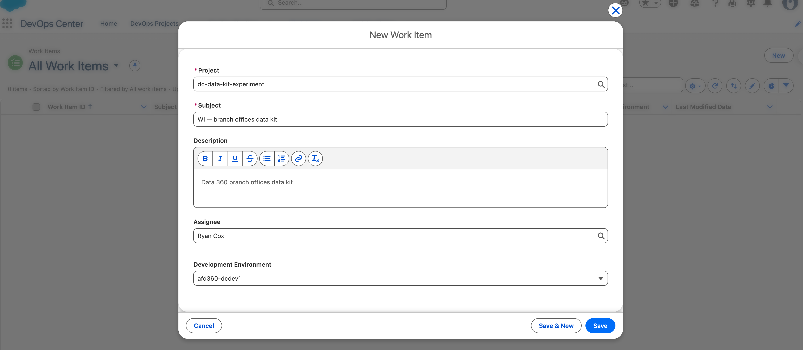
- The work item opens at status **New** (the tracker runs New → In Progress → In Review → Ready to
  Promote → Promoted → Closed). The **Branch** field is still empty — it's populated in §2.

  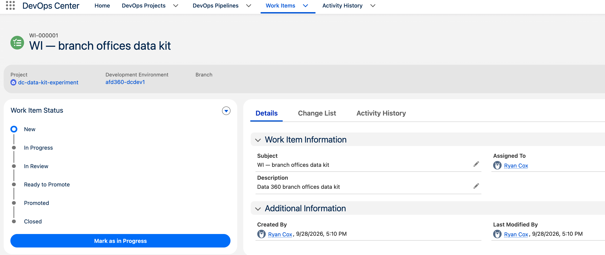

## 2. Move to In Progress

- Click **Mark as in Progress**.
- Lifecycle Center **auto-creates the feature branch** off the **first promotion stage's branch** — i.e.
  the Staging branch `dcstaging1` (not `main`; `main` is the Production stage).

  > **Verified branch name (2026-09-28):** the branch is **`WI-00000X`** (e.g. `WI-000001`) — **no
  > `feature/` prefix**, despite what you might expect. The work-item header shows it as
  > `<repo>/WI-000001` (e.g. `<your-pipeline-repo>/WI-000001`), and it appears on GitHub as
  > `refs/heads/WI-000001`.
- This requires **both** the pipeline to be **Active** (`10 §3b` step 6) **and** the connected dev
  environment (`dcdev1`). If the pipeline isn't active, the Staging branch was never cut, so this step
  fails with a bare **"An unexpected error occurred"** — see that step's note.
- **Done when:** a green **"Work item status updated successfully"** toast appears, the status tracker
  advances to **In Progress**, and the **Branch** field shows `<repo>/WI-000001`.

  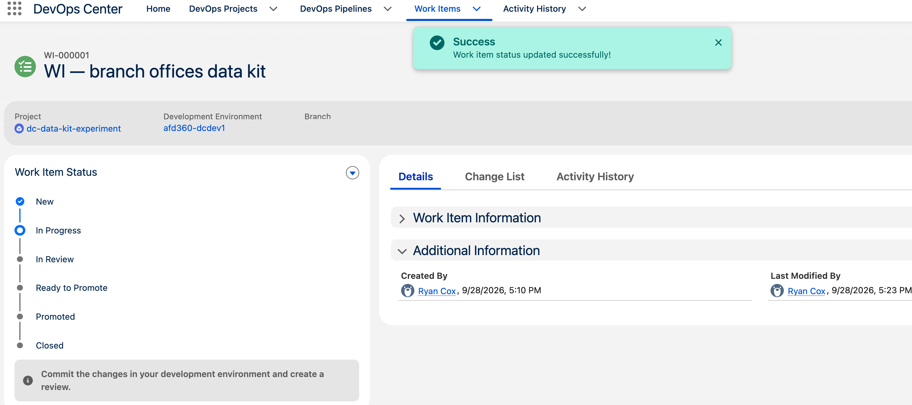

## 3. Commit the data kit from dcdev1 (DX Inspector)

With the work item **In Progress** (§2), commit the data-kit source from `dcdev1` via **DX Inspector**,
which commits straight onto the work item's branch (`WI-00000X`).

> **Finding (verified 2026-09-29) — this commit path does NOT work for data-kit metadata.**
> Committing a Data Cloud data kit through DX Inspector / Lifecycle Center reproducibly **fails at
> finalize** with `Commit failed during processing`: every component *stages* (all `COMMIT_COMPONENT`
> activity-log rows = SUCCESS) but the final commit step errors, so **nothing lands** on the
> `WI-00000X` branch. Isolated by A/B on the **same** pipeline — an ordinary Campaign field commits
> fine (`DORI-000000003` SUCCESS) while a 1-DMO kit fails (`DORI-000000004` ERROR); a 60-component kit
> failed twice earlier (`DORI-000000001/002`). So it's the data-kit metadata **as a class** — not repo,
> pipeline, kit size, or work-item state. **Re-tested 2026-10-12 on Winter '27 Patch 7.5 (264.7.5):
> still fails identically** (new kit, WI-000005 → `DORI-000000006` ERROR). Salesforce's documentation doesn't list DevOps
> Center / DX Inspector as a way to move data kits; the documented paths are the **`sf` CLI
> (manifest) and change sets** (see [`references.md`](references.md)). Treat it as not supported
> today.
>
> **So skip DX Inspector for the kit and use §3e:** commit the kit to the work-item branch with
> `scripts/commit-datakit-to-work-item.sh`, then promote in Lifecycle Center. This was verified end
> to end on 2026-10-26. If you want to move the kit outside the pipeline instead, use the CLI deploy
> in §3d. The §3a–§3c walkthrough is kept only to show the failure; it isn't a
> working promotion step.

### 3a. Open DX Inspector and connect it to the Lifecycle Center Hub

- In `dcdev1`, launch **DX Inspector** from the **hamburger menu** (top-left of any Data Cloud / Setup
  page) → **Change Management**. (DX Inspector is available by default; see `10 §5`.)

  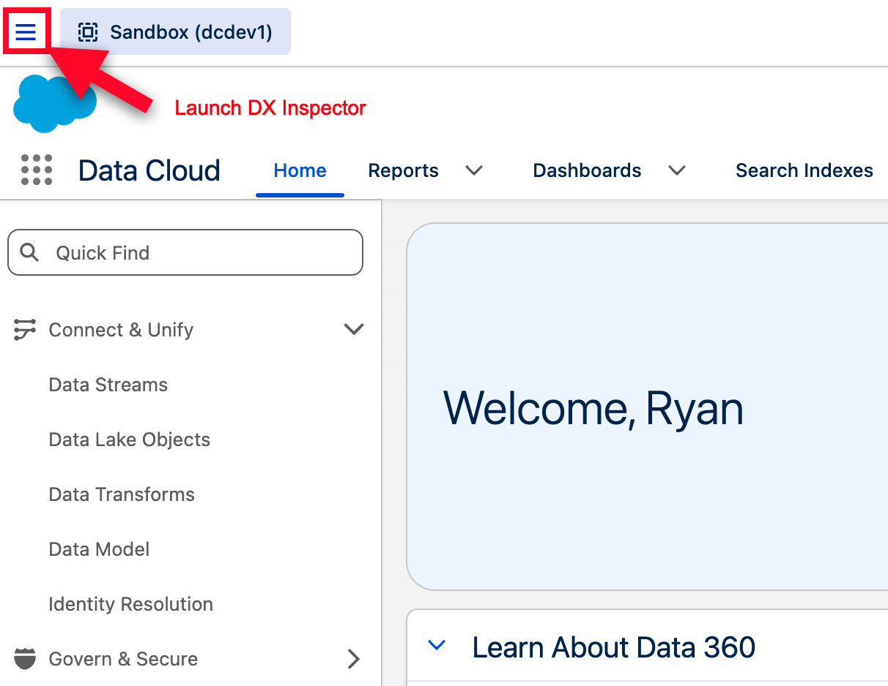
- **First time only:** until it's connected, the banner reads *"To view only uncommitted changes,
  connect to the org where you use DevOps Center…"* and DX Inspector lists **all** org metadata (here
  156 items, mostly unrelated). Click the sign-in banner (**Sign in to DevOps Center** before the rename).

  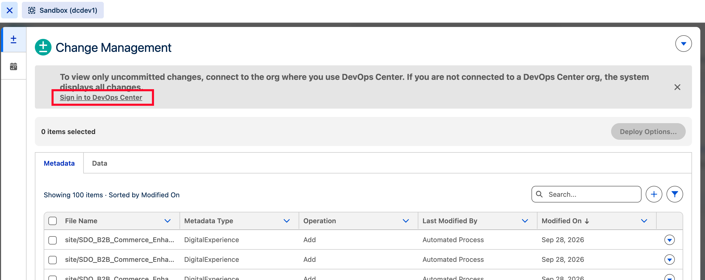
- Log in as the Hub user and **Confirm External Access** (the OAuth that links DX Inspector to the Hub).

  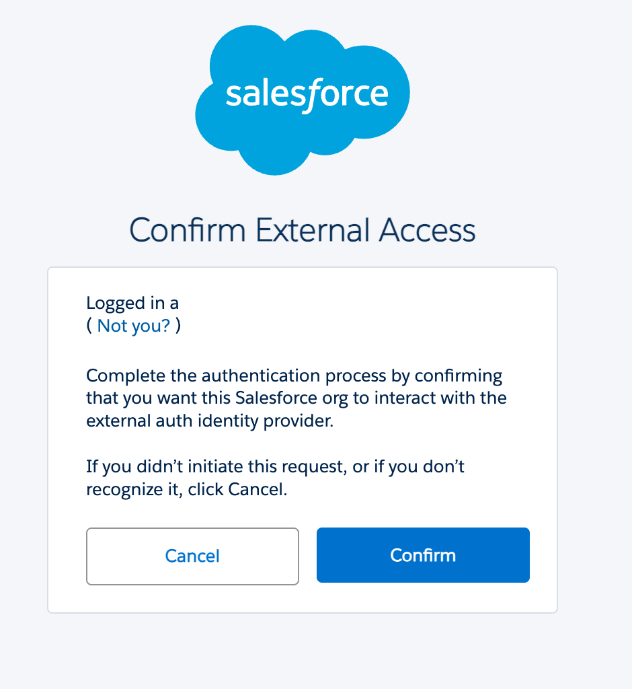
- **Connected when:** the header shows **"Connected to Lifecycle Center"** (*"Connected to ALM
  Devops Center Hub."* before the rename, as below). Only now can a commit
  be attached to a work item.

  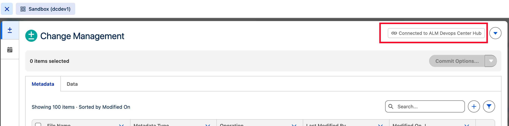

### 3b. Select the data-kit components

- On the **Metadata** tab, isolate the kit's components. This takes **two complementary filter passes**
  (not the same view twice), ticking the header checkbox to **select all** matches in each: filter
  **`branch`** for the kit's own metadata (the `branch_offices_*` components — **60** in this run, shown
  below), then filter **`upload`** for the `UploadedFiles*` connector pieces the kit depends on.
- **Observed data-kit metadata types** (what building this kit actually produced): `DataPackageKitDefinition`
  (the kit itself — *modify*), `DataKitObjectDependency` + `DataKitObjectTemplate` (the `UploadedFiles`
  connection), `DataStreamTemplate` (the stream bundle), and many `DataSrcDataModelFieldMap` (the
  DLO→DMO field maps).

  

  The **`upload`** pass is the second view — it surfaces the `UploadedFiles*` connector pieces
  (`UploadedFiles1` → `DataKitObjectDependency`, `UploadedFiles` → `DataKitObjectTemplate`) plus the
  `branch_offices_datakitUploaded*` field maps. The **60 items selected** count carries across both
  filtered views, so ticking each pass's matches builds up the one selection.

  
- Click **Commit Options… → Commit**.

### 3c. Commit to the work item (two-step wizard)

- **Step 1 — pick the work item.** In **Commit Files**, choose project `dc-data-kit-experiment` and
  select **WI-000001** (status `IN_PROGRESS`). → **Next**.

  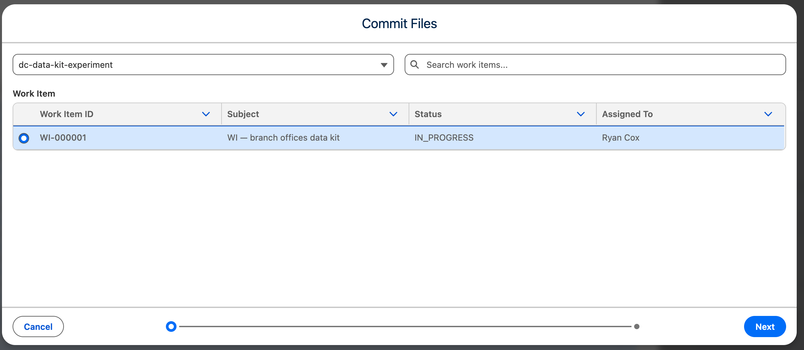
- **Step 2 — Preview, then Commit.** Enter the **Commit Comment** `Add branch offices data kit`. The
  Preview confirms **Commit To → Work Item WI-000001** and **Source Control Branch**
  `…/<your-pipeline-repo>/tree/WI-000001`, and lists the components. **Click the blue Commit button.**

  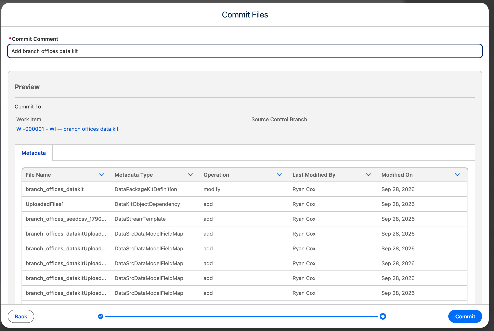

  > **Gotcha — the Preview screen is *not* the commit.** Reaching this Preview commits nothing; the
  > commit only happens when you click **Commit** (bottom-right). If you stop at the Preview, the work
  > item's **Change List** stays empty and nothing is pushed to the `WI-00000X` branch — verifiable with
  > `git ls-remote --heads origin dcstaging1 WI-00000X` still equal to `dcstaging1`. Always finish with **Commit** and
  > confirm the success state.
- **Sync check:** if Lifecycle Center warns your dev org is behind the source of truth, **sync first** to
  avoid conflicts.
- **Done when:** after clicking **Commit**, the work item's **Change List** tab lists the components and
  the branch on GitHub advances past `main`:
  ```bash
  git ls-remote --heads origin dcstaging1 WI-000001   # WI-000001 SHA now differs from dcstaging1's
  ```

### 3d. Supported path — deploy the kit via the `sf` CLI manifest

Because the DX Inspector commit (§3a–§3c) fails, move the kit with the **supported** CLI / Metadata-API
manifest path instead — scripted as [`scripts/deploy-datakit-cli.sh`](../scripts/deploy-datakit-cli.sh)
(idempotent, self-verifying; `--dry-run` validates only):

```bash
# validate first (changes nothing in the target):
scripts/deploy-datakit-cli.sh -k branch_offices_datakit -s afd360-dcdev1 -o afd360-dcstaging1 --dry-run
# then the real deploy (after activating the UploadedFiles connector — §6):
scripts/deploy-datakit-cli.sh -k branch_offices_datakit -s afd360-dcdev1 -o afd360-dcstaging1
```

What it does, and the one gotcha that makes it work:

1. **Fetch the kit manifest** from the source org — Connect REST
   `GET services/data/v64.0/ssot/datakit/<devName>/manifest` (beta) — and build a `package.xml` from
   its `dataKitMembers`.
2. **Retrieve** those components in metadata format from `dcdev1` into `tmp-cli-validation/<kit>/`
   (scratch, untracked — never `force-app/`).
3. **Strip the Key Qualifier (`KQ_*`) field.** Data Cloud generates a `KQ_OfficeCode__c` field on the
   DMO that does **not** appear as a manifest member — it rides **inline** in the retrieved
   `Branch_Office__dlm.object`. The Metadata API rejects it ("Key Qualifier Field cannot be deployed
   using Data Kits", KB 005224006), so the script drops that one `<fields>` block (the other 10 real
   fields stay). Skipping this is the difference between a clean deploy and a failure.
4. **Deploy** to the target with `sf project deploy start --metadata-dir …`. Validated end-to-end
   dev→staging: **33/33 components, zero failures** on `--dry-run` (2026-09-29).

This deploys the kit **definition** only — the §6 runtime wiring is still manual in the target.

> **Sources:** this is Salesforce's documented path,
> [Use CLI to Deploy Changes from Sandbox to Data 360](https://developer.salesforce.com/docs/data/data-cloud-dev/guide/dc-deploy_data_kit_using_cli.html).
> The Trailhead module [Data 360 Sandboxes](https://trailhead.salesforce.com/content/learn/modules/data-360-sandboxes)
> calls the CLI the "gold standard" for DevOps kits and lists change sets and third-party tools as the
> other options. It doesn't list Lifecycle Center (DevOps Center). A source-format copy of this kit retrieved this way is
> published at [`sf-d360-branches-datakit`](https://github.com/congmingwudi/sf-d360-branches-datakit).
> See [`references.md`](references.md).

> **Why a second deploy tool is allowed here.** This runbook otherwise forbids a second tool targeting
> these orgs; that rule is relaxed **for data kits only**, precisely because Lifecycle Center's commit
> can't carry them. Ordinary metadata still goes through Lifecycle Center.

### 3e. Recommended for data kits — commit the kit to the work-item branch with the script, then promote in Lifecycle Center

§3d moves the kit **around** the pipeline. This path keeps the kit **in** the pipeline: the script
does the Git commit (the step Lifecycle Center fails at), then the work item is reviewed and promoted
in the Lifecycle Center UI like any other. Scripted as
[`scripts/commit-datakit-to-work-item.sh`](../scripts/commit-datakit-to-work-item.sh).

It started as a workaround for the commit bug. We now recommend it for kits **even if DX Inspector
gets fixed**, because the kit itself decides what goes into the commit.

**You don't need DX Inspector for the kit at all.** Create the work item and move it to **In
Progress** (that creates the `WI-*` branch). Then run the script. You don't need to attempt a DX
Inspector commit and let it fail first. Lifecycle Center builds the work item's Change List by
*inspecting* the pushed branch, not from DX Inspector. On `WI-000008` the inspection
(`DORI-000000017`) created `WICL-000000016` straight from the pushed commit. That work item did have
an earlier failed DX Inspector attempt, but the inspected list doesn't depend on it.
**Confirmed on `WI-000009` (2026-10-27):** it had no DX Inspector commit attempt at all, and its only
Change List is the inspected `WICL-000000017` (§8 step 3).

**Why the script beats picking components in DX Inspector:**
- **The kit decides the contents.** The script asks the kit for its manifest
  (`GET /ssot/datakit/<name>/manifest`) and commits exactly that list, so nothing is missed or
  added. On `WI-000008` the two approaches differed a lot:
  - **DX Inspector (by hand):** 58 components (`WICL-000000015`). Its picks included what the
    running data stream created in dev: the DLO (`branch_offices_seedcsv__dll`), the
    `DataStreamDefinition`, `MktDataConnection` + 6 `MktDataConnectionSrcParam`s, 3
    `ObjectSourceTargetMap`s, and the `KQ_` field.
  - **Kit manifest:** 33 members. It has none of those and three the selection lacked:
    `DataSource`, `DataKitObjectTemplate`, and `DataKitObjectDependency` for `UploadedFiles`.

  A kit carries the stream as a **template** (bundle + `DataStreamTemplate`). The target creates
  its own DLO and connection when you activate the stream (§6), so the dev versions shouldn't be
  committed.
- **It fixes the two known failures before committing:** it removes the `KQ_*` field and raises
  `sourceApiVersion` to 64.0 (see below).
- **It validates before pushing.** `--validate-org` runs the promotion's own Metadata API deploy as
  check-only. If that fails, nothing is pushed.
- **It's repeatable.** Same inputs, same commit, for any kit, work item, or org.

**Limits:**
- **It covers the kit only.** Ordinary metadata in the same change (a flow or permission set that
  uses the DMO) still goes through DX Inspector. Put it in a **separate work item**, so a failed kit
  commit can't hold it up.
- **The kit's contents are only as good as the kit.** If a component was never added to the kit in
  Data Cloud Setup, the manifest leaves it out too. Check the kit's contents in Data Cloud Setup
  before you run the script. This is the step that replaces "did I select everything".
- **The manifest API is beta.** The script pins `--api-version` (default 64.0); re-check it when you
  move to a new API version.
- **It doesn't detect conflicts.** DX Inspector warns when the dev org's copy differs from the
  branch. The script commits whatever is in dev. `--validate-org` catches deploy failures, not
  upstream changes made by someone else.
- **Authorship.** The commit is authored as **you** (your git `user.name`/`user.email`), so the
  history doesn't credit the tool with a commit it didn't make. Lifecycle Center's own commits say
  `DevOps Center <noreply@salesforce.com>`. Pass that as `--author` only if you need the commit to
  look identical. `WI-000007`/`8` were committed that way, before the default changed.

**Why it fits (verified 2026-10-26 on the Hub).** A failed DX Inspector commit is only *half*
failed. The staged components are saved as `WorkItemComponent` rows under the work item's
`WorkItemComponentList` (for `WI-000007`: `WICL-000000008`, the 13 manifest members). What never
happens is the finalize step: the push to the `WI-*` branch, and writing the commit's
`CommitReference` / `CommitDate` / `CommitMessage` back onto that row. Compare the successful control
commit (`WI-000002`): its row carries SHA `a25d1a7…`, and on GitHub that commit is authored
`DevOps Center <noreply@salesforce.com>`, in source format under `force-app/main/default/`, with the
DX Inspector comment as the whole message. The script reproduces that commit and, if you opt in,
the row update.

**Two fixes the commit needs, both automated by the script:**
- **Strip the Key Qualifier field.** In source format it's its own file,
  `objects/Branch_Office__dlm/fields/KQ_OfficeCode__c.field-meta.xml`, which the script deletes (same
  reason as §3d step 3).
- **Raise `sfdx-project.json` `sourceApiVersion` (62.0 → 64.0).** The promotion deploys the branch at
  the project's API version. At 62.0 the Staging deploy fails, verified by check-only deploy:
  `DataPackageKitDefinition: Property 'useDeterministicNaming' not valid in version 62.0`, and then
  the `DataPackageKitObject` fails because its parent is missing. At 64.0: **13/13**. The change is
  committed with the kit, so it merges into `dcstaging1` (and later `main`) along with the kit.

#### Walkthrough: `WI-000007` (`branch_offices_test_datakit`) from dcdev1 to Staging

1. **Pre-check.** `WI-000007` is **In Progress** and its branch is still at the stage tip (`fd1cbb6`).
   The script checks both. The `default` data space exists in `dcstaging1` (`00 §5`).
2. **Dry run with Staging validation.** This builds the commit in an isolated worktree
   (`tmp-cli-validation/wi-commit/WI-000007/worktree`), runs a check-only deploy of exactly those files
   to `dcstaging1`, and cross-checks the manifest against the Hub's component list. It pushes nothing:

   ```bash
   scripts/commit-datakit-to-work-item.sh -k branch_offices_test_datakit -s afd360-dcdev1 \
       --hub afd360-prod -w WI-000007 --validate-org afd360-dcstaging1 --dry-run
   ```

   **Expect:** `Stripped 1 Key Qualifier field file(s)`, `Raised … 62.0 → 64.0`,
   `validation OK — 13/13 components`, 14 files in the commit (13 kit files + `sfdx-project.json`), and
   `in both: 13 of 13 manifest members` (verified 2026-10-26).
3. **Commit and push for real.** Drop `--dry-run`:

   ```bash
   scripts/commit-datakit-to-work-item.sh -k branch_offices_test_datakit -s afd360-dcdev1 \
       --hub afd360-prod -w WI-000007 --validate-org afd360-dcstaging1
   ```

   The push is fast-forward only, and the script verifies `origin/WI-000007` equals the new SHA. Check on
   GitHub: the branch is one commit ahead of `dcstaging1`.
4. **Check that Lifecycle Center sees it.** The script now does this for you: it waits for the
   inspected component list and prints `OK: the Change List matches the commit`. To confirm in the UI,
   go to Hub → Lifecycle Center → **Work Items → WI-000007** and look at the work item's changes.
   - **If it shows the commit and changes:** continue to step 5.
   - **If it doesn't** (no commit listed, or *In Review* is blocked for "no changes"): record the
     commit on the Hub the way the finalize step would have. Re-run step 3 with `--record-commit`. It's
     idempotent: no new commit, it only writes the SHA/date/message onto `WICL-000000008` and
     verifies it. This writes to Lifecycle Center's own bookkeeping, so it's opt-in. Note which branch
     you needed.
5. **In Review.** Move `WI-000007` to **In Review**. Lifecycle Center opens the PR
   `[DevOps Center] Merge WI-000007 to dcstaging1` (`WI-000007` → `dcstaging1`, not `main`). Check with
   `gh pr list --repo <owner>/<your-pipeline-repo>`. **Don't merge it on GitHub.** Promotion merges it,
   and Lifecycle Center's PR text warns that merging outside it leaves you to deploy by hand.
6. **(Optional) arm the §5a deploy-mechanism watch.** Run
   `scripts/watch-datakit-deploy.sh -o afd360-dcstaging1 -u <your-username>.dcstaging1 --arm`. This is the first real Lifecycle
   Center promotion of a data kit, so it's the moment to answer experiment 1 (Metadata API vs.
   `sfdatakit` flow).
7. **Ready to Promote, then Promote to Staging.** In **Pipelines**, select `WI-000007` on the
   Development → Staging lane and **Promote**. Lifecycle Center merges the PR into `dcstaging1` and
   deploys to `afd360-dcstaging1`. Follow it on the Hub:

   ```bash
   sf data query -o afd360-prod --query \
     "SELECT Name, OperationType, Status, Message, CreatedDate FROM DevopsRequestInfo ORDER BY CreatedDate DESC LIMIT 3"
   ```
8. **Verify in Staging.**
   `sf org list metadata --metadata-type DataPackageKitDefinition -o afd360-dcstaging1` lists
   `branch_offices_test_datakit`, and **Data Cloud Setup → Data Kits** shows it with the `Branch Office`
   DMO. If you armed step 6, run
   `scripts/watch-datakit-deploy.sh -o afd360-dcstaging1 -u <your-username>.dcstaging1 --collect`.
9. **§6 runtime wiring.** The one-DMO test kit has **no stream or connection**, so §6 steps 2–3
   don't apply: just confirm the DMO and its 10 fields exist. With the full `branch_offices_datakit`
   (new work item, same script), do all of §6.

**If the promotion deploy fails.** Read the error from `DevopsRequestInfo.Message` and the target's
**Deployment Status**. One thing to watch: the Hub records the DMO's fields as `Branch_Office.<Field>`
with no `__dlm` (the source and manifest say `Branch_Office__dlm.<Field>`). If Lifecycle Center builds
its deploy from those Hub rows instead of the branch, the fields could be skipped or fail. That
naming mismatch is also a candidate cause of the original commit failure, worth adding to the
support case. To recover, deploy the kit with §3d; the merge into `dcstaging1` has already happened.

#### Result (2026-10-26): the workaround works end to end

- **Commit.** `41fd6b4` was pushed to `WI-000007` (13 components, KQ_ field stripped,
  `sourceApiVersion` 64.0).
- **Lifecycle Center picked it up on its own (step 4).** It *inspected* the branch and created
  `WICL-000000009` with `CommitReference = 41fd6b4` and 13 NEW components. The activity log shows
  Commit Started, then 13 × Commit Component, then Commit Completed = **SUCCESS**. `--record-commit` was
  **not needed**, and the failed DX Inspector list `WICL-000000008` stayed untouched.
  - This inspection recorded the DMO fields **with** `__dlm` (`Branch_Office__dlm.<Field>`).
    The failed DX Inspector commit recorded them without it, which strengthens the naming-mismatch
    lead for the support case.
  - Several concurrent INSPECT requests (`DORI-000000010`–`014`) failed with *"Failed to create
    WorkItemComponentList records - all records were rolled back"*. These are harmless: one
    inspection (`DORI-000000009`) succeeded and the others lost the race.
- **Promotion.** `DORI-000000015` PROMOTE ended **SUCCESS** ("Promotion completed successfully").
  - Lifecycle Center merged PR #1, so `dcstaging1` moved `fd1cbb6` → `b0d73d9` ("Merge branch
    'WI-000007' into dcstaging1"). `WI-000007` is now **PROMOTED** and sits in the Staging column.
  - Target deploy `0AfDR00003eTyca0AC` in `afd360-dcstaging1` **Succeeded, 13/13, 0 errors**. It
    created `DataPackageKitDefinition branch_offices_test_datakit`, `DataPackageKitObject`,
    `CustomObject Branch_Office__dlm`, and its 10 `CustomField`s.
- **Mechanism (experiment 1).** No ApexLogs ran under the armed trace flag during the deploy (`--collect`).
  So this was a **pure Metadata API deploy**, with no `sfdatakit` flow involved.
- **Full kit (`WI-000008`, `branch_offices_datakit`).** The script committed `13e4b7e` (22 new files on top of
  the DMO already in `dcstaging1`). Validation against Staging passed 35/35. The inspection created
  `WICL-000000016` with 22 components. That first run's Hub cross-check ran before the inspection.
  So it compared against the failed DX Inspector list (`WICL-000000015`), and its "Hub only" lines
  were DX Inspector's extra picks. **Fixed:** the script now waits for the inspected list, finds it
  by `CommitReference` = the pushed SHA, and compares it to the kit members the commit changed.
  Re-run on `WI-000008`: *"changed in commit: 22 of 33 … in both: 22 … OK: the Change List matches
  the commit."*
- **Conclusion.** Only the *commit* step is broken for data kits. Inspection, PR, merge, and
  promotion deploy all work once the kit source is on the `WI-*` branch.
- **But promotion only installs the kit.** `WI-000008`'s promotion (`dcstaging1` =
  `45da005`, deploy `0AfDR00003eTycp0AC`, 22/22) left staging with no stream, DLO, or mapping. They
  appeared only after the kit's components were deployed with
  [`scripts/deploy-datakit-components.sh`](../scripts/deploy-datakit-components.sh) (§6 step 3).

## 4. Review (Pull Request)

- After the script's commit (§3e), open DX Inspector in `dcdev1` on the work item and click
  **Create Review**. Lifecycle Center opens a **pull request** targeting the **Staging** branch
  (`WI-00000X` → `dcstaging1`, not `main`) and moves the work item to **In Review**.

  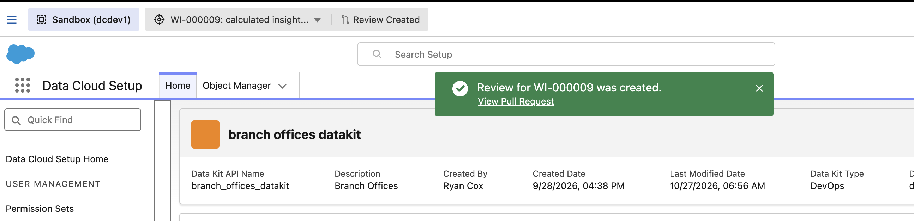
- Review the diff (this is where a teammate approves), then **Mark as Ready to Promote**. Don't
  merge the PR on GitHub yourself: Lifecycle Center merges it when it promotes.

  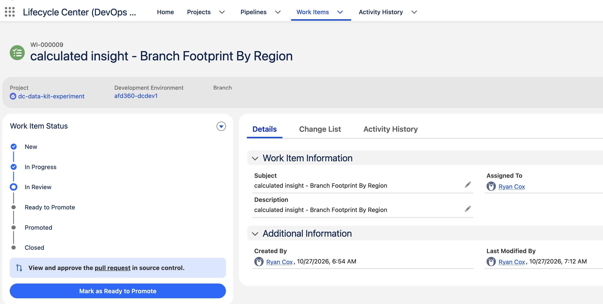

## 5. Promote to Staging (the key hop)

> **Works for data kits once the script has committed them (§3e; verified 2026-10-26/27 with
> WI-000007, 8 and 9).** DX Inspector's commit is the only broken step. After the script's commit,
> review and promotion run as they do for any metadata.

- With the work item **Ready to Promote**, open the pipeline: it's listed under **Approved Work
  Items**. Select it and click **Promote Selected**.

  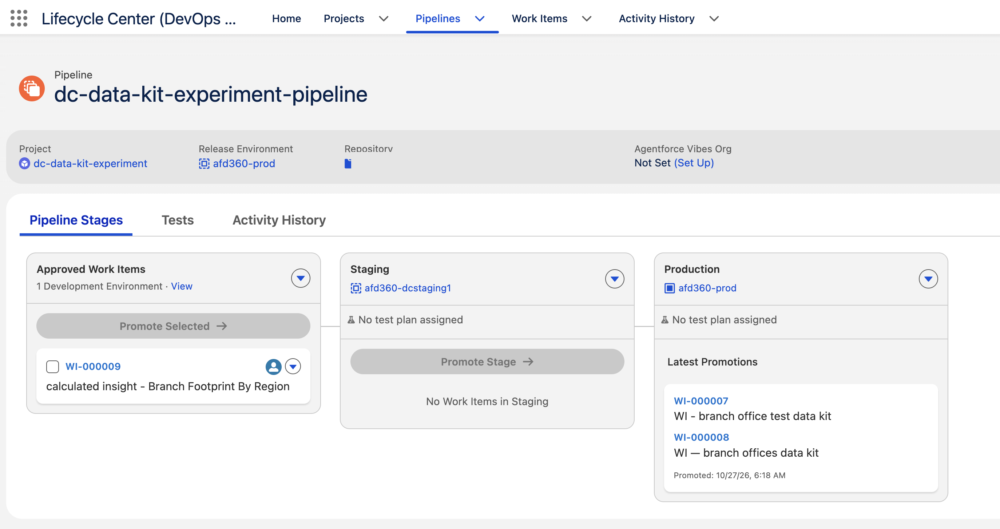
- **Promotion Options:** keep *Only changes missing from Staging* and *No tests*.

  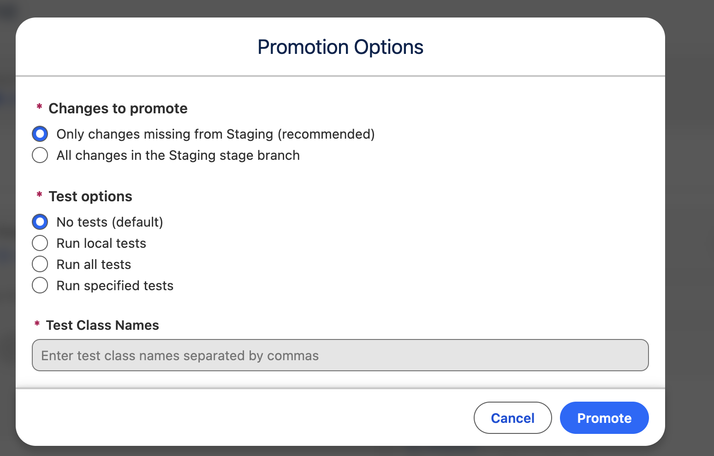
- Lifecycle Center merges the `WI-*` branch into the **Staging branch** and **deploys the data kit to
  `dcstaging1`**. The work item moves to the Staging column.

  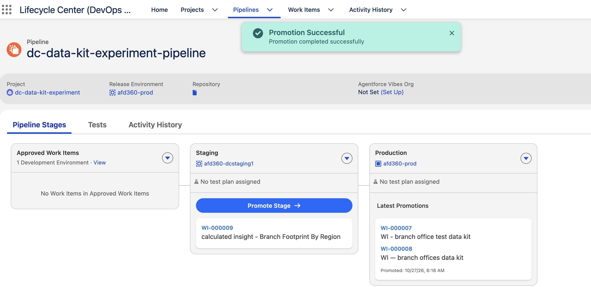
- This deploy only **installs** the kit. Continue with §6 to deploy its components.
- You can also promote via **Salesforce CLI** (see `40-mcp-optional.md`).

> **How Lifecycle Center deploys the kit — the Metadata API path.** Lifecycle Center is a **source-driven**
> deployment tool, and a Data Cloud data kit built for it is just **metadata**. Building the kit in
> `dcdev1` produces Salesforce DX source for the data-kit *metadata* types (the
> `DataPackageKitDefinition` + related types committed in §3), written under `force-app/` on the
> feature branch. Promotion runs **no Data Cloud-specific installer**: Lifecycle Center merges the branch
> and performs a standard **Metadata API deploy** of those components into the target org. So the unit
> that crosses is the **kit definition as metadata**, not a runtime install. Two specifics:
> - **Kit type decides the deploy path.** `DataPackageKitDefinition.dataKitType` is `Sandbox` (the
>   UI's **"DevOps"** kit type) for kits built for this metadata-deploy path — as opposed to
>   `Default`/**"Standard"** kits, which ship as a *package you install* and then hydrate at runtime via
>   the `sfdatakit__DeployDataKitComponents` flow. Lifecycle Center is **expected** to use the
>   Sandbox/DevOps (Metadata API) path rather than that flow — but we don't assert it: **experiment 1
>   confirms it empirically** by watching the target during the Staging promotion (see §5a).
>   (`dataKitType` is API v63.0+.)
> - **What the deploy binds.** `deploymentOrder` sequences the kit's components, and
>   `dataSpaceDefinitionDevName` (v61.0+) binds the kit to the **same-named data space in the target**
>   — which is why that space must already exist (`00 §5`). The Metadata API carries the kit
>   *definition* only; the runtime wiring in §6 is **not** part of the deploy. (Sources:
>   [`DataPackageKitDefinition`](https://developer.salesforce.com/docs/atlas.en-us.api_meta.meta/api_meta/meta_datapackagekitdefinition.htm),
>   [metadata cheat sheet](https://developer.salesforce.com/docs/data/data-cloud-dev/guide/component-cheatsheet.html).)
- **Done when:** the deploy succeeds and the data-kit components appear in `dcstaging1`'s Data Cloud
  setup. Then do the manual runtime wiring in §6 — this is the delta the experiment is about.

## 5a. Watch *how* the kit deploys (experiment-1 verification)

> **Answered (2026-10-26, WI-000007).** With the trace flag armed, the Staging promotion produced
> **no ApexLogs**, and the deploy (`0AfDR00003eTyca0AC`) listed the data-kit types as deployed
> metadata. So Lifecycle Center deploys a kit as a **pure Metadata API deploy**, with no
> `sfdatakit__DeployDataKitComponents` flow (§3e result). You don't need to repeat this; the steps
> below are kept so the check can be re-run on another pipeline.

We claim (§5) Lifecycle Center deploys the kit via the **Metadata API**, not the
`sfdatakit__DeployDataKitComponents` flow. Don't take it on faith — instrument the **target**
(`dcstaging1`) **before** you promote, then read three signals. Do this on the very first Staging
promotion; once confirmed, later runs don't need it.

> **Scripted:** `scripts/watch-datakit-deploy.sh -o <target> -u <deploy-user>` automates signals 2 and 3 —
> `--status` (pre-flight), `--arm` (set the debug-log trace flag before promoting), `--collect`
> (gather evidence after). `-u` is required: the stage's Lifecycle Center OAuth user (§5a below
> uses Staging's). Signal 1 stays a UI check. The three signals further down are what it reads.

**Run sheet — do this in order the first time you promote to Staging (§5):**

1. **Pre-flight** — `scripts/watch-datakit-deploy.sh -o afd360-dcstaging1 -u <your-username>.dcstaging1` (`--status`). Confirms
   whether the `sfdatakit` package/flow is even present and that no stale trace flag is active.
   *(As checked 2026-09-28, `sfdatakit` is **not** installed in `dcstaging1` — so today the flow path
   is impossible there, i.e. signal 3 already leans "Metadata API by elimination." Re-confirm at run
   time, since a deploy could change that.)*
2. **Arm** — `scripts/watch-datakit-deploy.sh -o afd360-dcstaging1 -u <your-username>.dcstaging1 --arm`.
   Sets the debug-log trace flag on that deploy user (Staging's Lifecycle Center OAuth identity). Do this **before** promoting.
3. **Promote** — carry out the §5 promotion (Ready to Promote → Promote to Staging).
4. **Collect** — once the deploy finishes,
   `scripts/watch-datakit-deploy.sh -o afd360-dcstaging1 -u <your-username>.dcstaging1 --collect`. Reads the deploy user's `ApexLog`s and reports flow-path vs. metadata-path evidence.
5. **Confirm signal 1 (authoritative)** — in `dcstaging1`, **Setup → Deployment Status**: open the
   promotion's deploy and confirm the data-kit component types are listed as deployed metadata.
6. **Record** the verdict in §7 (metadata vs. flow, with the evidence).

**The three signals (what the run sheet reads):**

1. **Metadata-deploy record — positive proof of the Metadata API path.** In `dcstaging1`, open
   **Setup → Deployment Status** right after the promotion. A Lifecycle Center promotion lands here as a
   **Metadata API deploy**; open it and confirm the component list includes the data-kit types
   (`DataPackageKitDefinition`, `DataPackageKitObject`, `DataStreamDefinition`, …). If the kit's
   components appear as *deployed metadata components*, the Metadata API path is what ran.
   - *If it's scriptable in these orgs:* the Tooling API exposes recent deploys (confirm the object/
     fields in-org before relying on it) — otherwise the Deployment Status UI is the source of truth.

2. **Debug log — did the flow run?** Before promoting, set a **debug log** in `dcstaging1` on the
   identity Lifecycle Center deploys as — i.e. the user whose OAuth you approved when connecting the
   Staging environment (`10 §3b` step 3, the `ALMDevOpsConnectedApp` consent). Use a DebugLevel that
   captures **Apex Code** and **Workflow** at `FINE`/`FINEST`. After the promotion, read the resulting
   `ApexLog`(s) and search for `sfdatakit`, `DeployDataKitComponents`, or `FLOW_START_INTERVIEWS`:
   - **present** ⇒ the deploy did invoke the data-kit flow;
   - **absent** (only metadata-deploy activity) ⇒ pure Metadata API path — corroborating §5.
   - *Honest caveat:* a Metadata API deploy runs under Lifecycle Center's integration context, and an
     autolaunched flow could execute as the **Automated Process** user, so a debug log may not capture
     everything. Treat signal 1 as the reliable positive proof and this as the "was a flow involved at
     all?" detector; if in doubt, also trace the Automated Process user.

3. **Feasibility bound — is the flow even present?** Check whether the `sfdatakit` package and its
   `sfdatakit__DeployDataKitComponents` flow are installed/active in `dcstaging1` (Setup → Installed
   Packages / Flows, or query `FlowDefinitionView`). If that flow isn't present, the flow path is
   impossible and the Metadata API path is confirmed **by elimination**.

- **Done when:** you can state, from the deploy record (and debug log), whether the promotion deployed
  the kit as **metadata** or ran the **`sfdatakit__DeployDataKitComponents` flow** — and you've
  recorded that finding in §7. That resolves the one inference §5 leaves open.

## 5b. Promote to Production

- Only after Staging looks right, promote the work item **on to the Production stage**.
- Lifecycle Center merges the Staging branch into **`main`** and **deploys to `afd360-prod`**.
- **Note:** Data Cloud is already provisioned in `afd360-prod` (it's the parent prerequisite for Data
  Cloud in the sandboxes), so the tenant is in place — but you still redo the §6 runtime wiring in
  prod, just as in any target.
- **Promote Stage promotes the whole stage**, not single work items. It merges the Staging branch's
  pull request (`dcstaging1 → main`), so every work item in Staging goes together. Git would force
  this anyway: each `WI-*` branch is cut from `dcstaging1`, so a later work item contains the earlier
  ones' commits.
- **If you see *"Can't validate promotion"*** (*"…your source control is checking the pull
  request. Try again later."*), GitHub is still computing whether the PR can merge. Wait a minute
  and click **Promote Stage** again. **View Pull Request** shows GitHub's "Checking for ability to
  merge" banner while it's still working.

  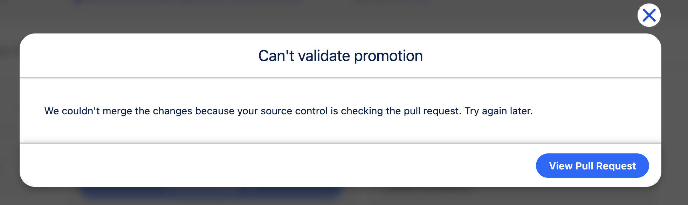
- **Promotion Options:** the defaults are right for a data kit. Use **Promote Now**, **Only changes
  missing from Production**, and **No tests** (there's no Apex).

  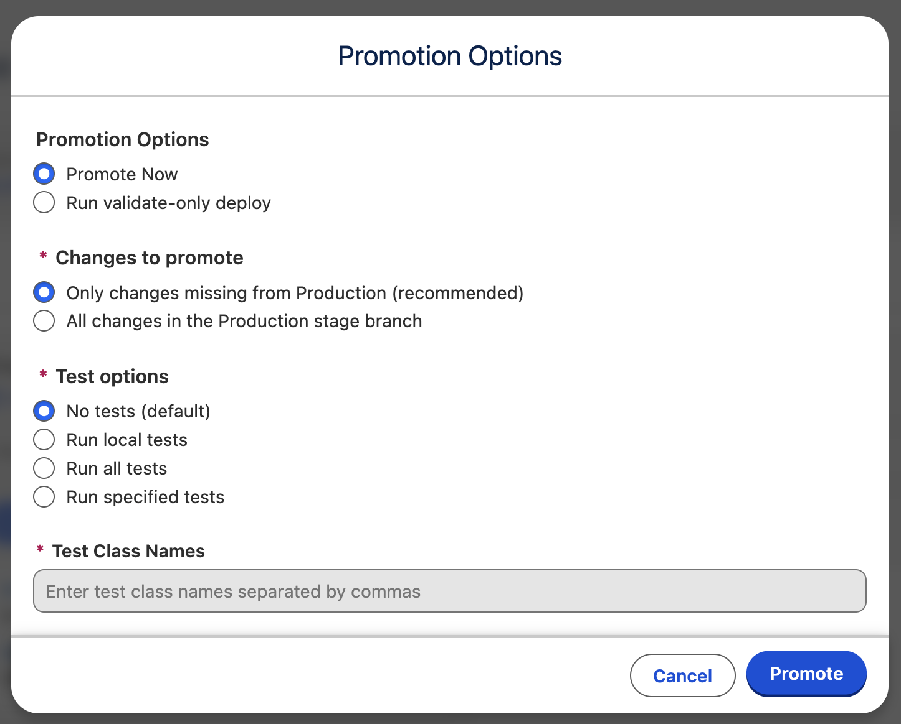
- Run §6 in `afd360-prod`. The promotion only installs the kit; run
  `./scripts/deploy-datakit-components.sh -k branch_offices_datakit -o afd360-prod --dry-run` first
  and read its deployment log.
- Work item → **Promoted**. (Close it when you're satisfied.)
- **Done when:** the deploy succeeds and — after repeating the §6 runtime wiring **in `afd360-prod`** —
  the data-kit components appear in prod's Data Cloud setup.

> **Result in `afd360-prod` (2026-10-27).** Promote Stage took WI-000007 and WI-000008 together.
> - **Git:** pull request #2 merged into `main` as `31b6b61`.
> - **Metadata deploy:** `0AfKa00000iyM8tKAE` succeeded at 13:18 UTC, 35 components, 0 errors.
> - **Installed:** both `branch_offices_datakit` and `branch_offices_test_datakit`.
> - **DMO:** `Branch_Office__dlm` arrived with WI-000007's commit, although WI-000008's own Change
>   List doesn't include it.
>
> 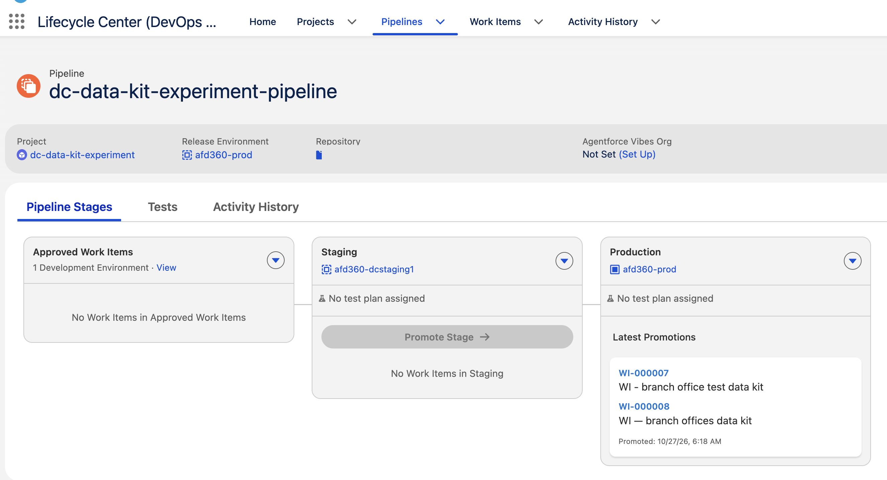
>
> **The install-vs-deploy caveat is settled: a Metadata API install never deploys components.**
> Prod's UploadedFiles connection was already **ACTIVE** before the install. The kit's deployment
> log still had **no rows** and the stream didn't exist. Staging's inactive connection wasn't the
> reason. The component deploy (job `08PKa00000qP9r8`, 13:23 UTC) then logged three Successful rows:
> the kit, `UploadedFiles`, and `branch_offices_seedcsv`. It created the INACTIVE stream and the
> DLO → `Branch_Office__dlm` map with 10 field maps, the same 10/11 as staging (§7).
>
> **Prod works end to end.** After the §6 step 4 Update File upload (13:29 UTC), the stream is
> **Active**, its last run is **Success**, and it processed **50** records. Data Cloud SQL
> `COUNT(*)` returns **50** in `branch_offices_seedcsv__dll` and **50** in `Branch_Office__dlm`.
>
> 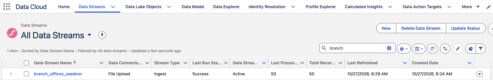

## 6. Manual post-deploy in the target (expected — not a failure)

Run this in **`dcstaging1`** after the Staging promotion, and again in **`afd360-prod`** after
Promote Stage (§5b). After an update (§8) only steps 3 and the insight run are needed. The
definition deployed; now wire the runtime:

1. Confirm the **data space** exists (pre-created in `00-prereqs.md §5`).
2. **Activate the UploadedFiles connection if it's inactive** (connection type **File Upload**,
   under **Data Cloud Setup → Other Connectors**). In `dcstaging1` it was inactive, and File Upload
   isn't selectable until you activate it. In `afd360-prod` it was already **ACTIVE** and the kit
   left it alone, so this step was skipped there. To check:
   ```bash
   sf data query -o afd360-prod --query "SELECT DeveloperName, ConnectionState FROM MktDataConnection WHERE DeveloperName = 'UploadedFiles'"
   ```
   The file itself is re-uploaded in step 4.
3. **Deploy the kit's components.** The promotion only *installs* the kit (definition, templates,
   publishing sequence). It doesn't create the stream, DLO, or mapping. That's the kit's **Deploy**
   action, which you can run with the script. Dry-run first: it compares each publishing-sequence
   item with the kit's deployment log and deploys only if some item was never deployed:
   ```bash
   scripts/deploy-datakit-components.sh -k branch_offices_datakit -o afd360-dcstaging1 --dry-run
   scripts/deploy-datakit-components.sh -k branch_offices_datakit -o afd360-dcstaging1
   ```
   It calls the Connect API (`POST /ssot/data-kits/<kit>?asyncMode=true`, then polls
   `/ssot/datakit-deployment-job/<jobId>`). Do it **after** step 2: an inactive connection fails the
   job. If the kit page says *"Publishing sequence not defined"*, the job has nothing to run; fix
   the sequence in the source org and re-promote.
4. **Upload the file to activate the stream (UI only).** The stream arrives **INACTIVE**, and there's
   no separate Activate button or API for it. Open **Data Streams → `branch_offices_seedcsv`** →
   **Update File**:

   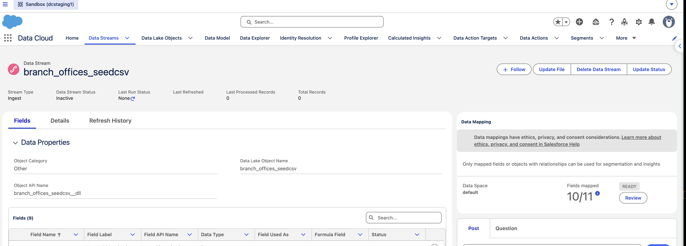

   You can also start it from the **Data Streams** list: open the stream row's menu → **Update File**.

   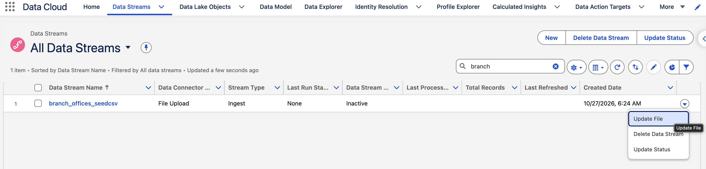

   Keep the **Full Refresh** mode the kit carried, upload
   [`data/branch-offices-seed.csv`](../data/branch-offices-seed.csv), wait for *File Upload
   Complete*, then click **Deploy**:

   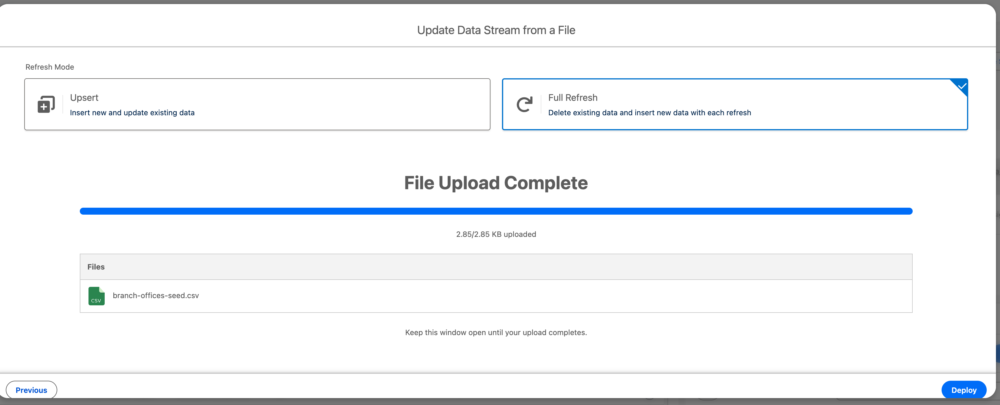

   The stream turns **Active** and runs once. Check it with:
   `sf api request rest services/data/v64.0/ssot/data-streams/<stream-id> -o <org>`. Look for
   `status` ACTIVE, `lastRunStatus` SUCCESS, record counts, and
   `advancedAttributes.isDataStreamConfigValid` = `true`.

   > **Why the upload is always needed.** A data kit carries the stream's **configuration** but not
   > the **uploaded file** or any ingested records. For File Upload, that configuration includes a
   > pointer to where the file is stored in Data Cloud, and the kit copies it unchanged. Before the
   > upload, staging's stream pointed at dev1's 2026-09-28 upload and reported
   > `isDataStreamConfigValid: false` with 0 records. The upload points it at the target's own copy.
   > Streams from external sources (S3, SFTP, CRM) shouldn't have this gap, but we haven't tested them.
5. Verify the **DLO→DMO mapping** came across; hand-fix any partial DMO pieces.
6. Confirm the DMO previews data in `dcstaging1`.

> **Result in `dcstaging1` (2026-10-26).** After the Update File upload, the stream was ACTIVE and
> SUCCESS with 50/50 records. A Data Cloud SQL `COUNT(*)` (`POST /ssot/queryv2`) returned **50** in
> `branch_offices_seedcsv__dll` and **50** in `branch_office__dlm`. The mapping still shows
> **10/11** fields (see §7).

> **Install vs. deploy (verified 2026-10-26).** After `WI-000008`'s promotion, `dcstaging1` had the
> kit with its templates and publishing sequence, but no `branch_offices` stream. The script's job
> `08PDR00000DA55U` ended `Complete` and created:
> - stream `branch_offices_seedcsv`, INACTIVE. It's named after the DLO, not the source's
>   `branch-offices-seed.csv` label.
> - DLO `branch_offices_seedcsv__dll`. The job creates the `KQ_OfficeCode__c` field itself, which
>   is why it's stripped from the Metadata API deploy.
> - the DLO → `branch_office__dlm` map, with 10 field maps.
>
> A second, accidental run failed with *"A data lake object with the name … already exists"*. It
> was started while the first job was still running (it began at 21:51:11; the first job logged its
> stream at 21:51:41), so the two **concurrent** jobs both tried to create the DLO. A redeploy started
> after the first job finishes works: on 2026-10-27 the bundle redeployed in place (§8 step 4). Never
> run two deploys of one kit at once.
>
> **Why the install didn't deploy them.** The change-set doc says a kit's *first* change-set
> install deploys its components automatically. A Metadata API install (Lifecycle Center's promotion
> or the CLI) doesn't. `branch_offices_datakit` was first installed at 21:33 UTC, and
> `DataKitDeploymentLog`, the kit's Deployment History, had **no rows** until our job at 21:51.
> Nothing even attempted a deploy. The script prints this log in its pre-flight for each target.
> Details and sources:
> [`references.md` → DevOps vs. Standard](references.md#devops-vs-standard-data-kits-compiled-2026-10-27).
>
> API quirks the guide doesn't mention:
> - The endpoint exists only at **v64.0+** (NOT_FOUND on v62/v63).
> - v64.0 rejects the guide's `{"developerName": …}` body; send `{}`.
> - The final status is `Complete`, not `Completed`.

> **Step 4 is always needed; step 2 only when the connection is inactive.** KB 003960830 says a
> connection *becomes inactive in the target when its data streams are deployed in a kit*. That
> didn't happen in `afd360-prod` (2026-10-27). Its UploadedFiles connection stayed ACTIVE and wasn't
> modified (last modified 2026-02-24). The kit builder's own warning explains it: connector metadata
> updates in the target only *"if no active connector with the same API name already exists"*
> (`20-build-data-kit.md §4`). So a connection that's already active in the target is left alone,
> and you only activate it where it isn't, as in `dcstaging1`. The Trailhead module adds that for non-CRM connectors (like File
> Upload) you only need to activate the connector, with no redeploy, then **Start Ingestion**. Also check **Data Kits → (kit) → Deployment History** in the target. Trailhead says
> to change a deployed component with a **new** kit, but *adding* a component to the same kit and
> redeploying worked (§8). See [`references.md`](references.md).

- **Done when:** the target org (`dcstaging1`, then `afd360-prod`) shows
  the same stream → DLO → DMO, populated.

## 7. Record what needed hand-fixing

Log any manual steps here (or in a follow-up doc) so the experiment yields a reusable, honest runbook. That delta — "what Lifecycle Center carried vs. what we redid" — is the actual finding of this experiment.

**Headline finding, part 1 (verified 2026-09-29, re-tested on 264.7.5): DX Inspector can't commit a
data kit.** Every component stages, then the commit fails at finalize (§3 banner). **The fix
(verified 2026-10-26/27):** commit the kit with `scripts/commit-datakit-to-work-item.sh` (§3e). The
rest of Lifecycle Center (inspection, review, Promote Selected, Promote Stage) then works for the kit
all the way to Production. The CLI deploy (§3d) stays available for moving a kit outside the pipeline.

**Headline finding, part 2: a promotion only installs the kit.** It's a pure Metadata API deploy
(§5a: no ApexLogs, no `sfdatakit` flow) that brings the definition, templates and publishing sequence,
and creates nothing that runs. In each target you then run the component deploy
(`scripts/deploy-datakit-components.sh`), activate the connection if it's inactive, upload the file
once to activate the stream, and run any new calculated insight. That is the delta below.

**Delta: one system field map didn't cross (2026-10-26; same in `afd360-prod` 2026-10-27).** The
deployed DLO → DMO map in `dcstaging1` has **10 of 11** field maps. The stream page shows *Fields mapped 10/11*. `dcdev1` also
maps the system field `cdp_sys_SourceVersion__c`. The first ingestion **didn't** add it, so the kit
doesn't carry it. All 50 rows still reached the DMO, so it's low impact. If you need it, map it by
hand in the target (stream → Data Mapping → **Review**). To compare the maps between orgs:
`sf api request rest "services/data/v64.0/ssot/data-model-object-mappings?dataspace=default&dmoDeveloperName=branch_office__dlm" -o <org>`.

**Delta: the uploaded file never crosses.** Every target needs the §6 step 4 **Update File** upload
before its File Upload stream can activate. It's a UI step with no public API we found. Re-running
ingestion afterwards *is* scriptable: `POST /ssot/data-streams/<name>/actions/run` exists. We
probed it, but haven't run it.

**Publishing-sequence banner: cosmetic (confirmed 2026-10-27).** In `dcdev1` the kit's **"You
haven't defined the publishing sequence…"** banner persisted even after Edit Sequence → Save
(`20-build-data-kit.md §4`). It had no effect: the committed `DataPackageKitDefinition` carries a
populated `deploymentOrder` (WI-000009's commit added a third entry to it, §8 step 3), and both
targets deployed the components in that order (connection → bundle → insight).

## 8. Update-only promotion: add a calculated insight to the kit (verified in Staging and Production, 2026-10-27)

The question: once a kit is deployed in a target, what happens when you add a component to it and
promote again? The test adds a calculated insight (CI) to `branch_offices_datakit` in `dcdev1` and
promotes it to `dcstaging1` on a new work item.

1. **Create the CI in `dcdev1`.** It's *Branch Footprint by Region*
   (`branch_footprint_by_region__cio`): the number of offices per region and country, from
   `Branch_Office__dlm`. Check it against the CSV, for example West = 7, with all 50 offices in total.
   ```bash
   ./scripts/create-calculated-insight.sh -o afd360-dcdev1 --dry-run
   ./scripts/create-calculated-insight.sh -o afd360-dcdev1 --run
   ```
   The script creates it through the Connect API (`POST /ssot/calculated-insights`), runs it once
   (`…/actions/run`), and prints its rows. The same SQL, run as a plain query in `dcdev1`, returned
   the expected per-region counts.

   **Result in `dcdev1` (2026-10-27):** the insight was created and is Active, in the `default` data
   space, Not Scheduled. Its first run succeeded at 13:48:59 UTC
   (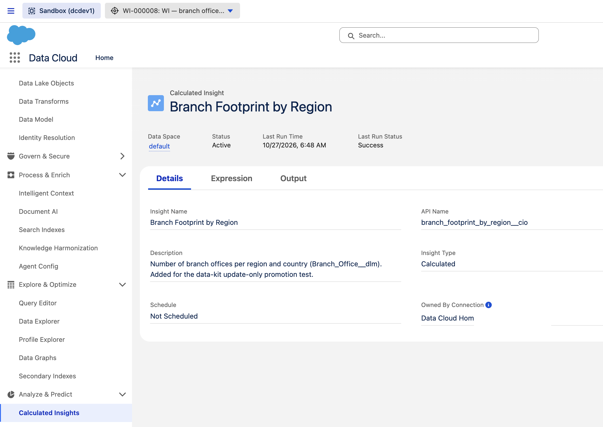).
2. **Add it to the kit (UI):** Data Kits → `branch offices datakit` → add the calculated insight.
   Then open the **Publishing Sequence** tab and check that it's listed after the stream bundle. Once
   a sequence has been edited, Data 360 doesn't update it by itself when components are added
   (change-set doc, [`references.md`](references.md)).

   **Result:** the kit's **Add Calculated Insights** dialog lists it under *Branch Footprint by
   Region* (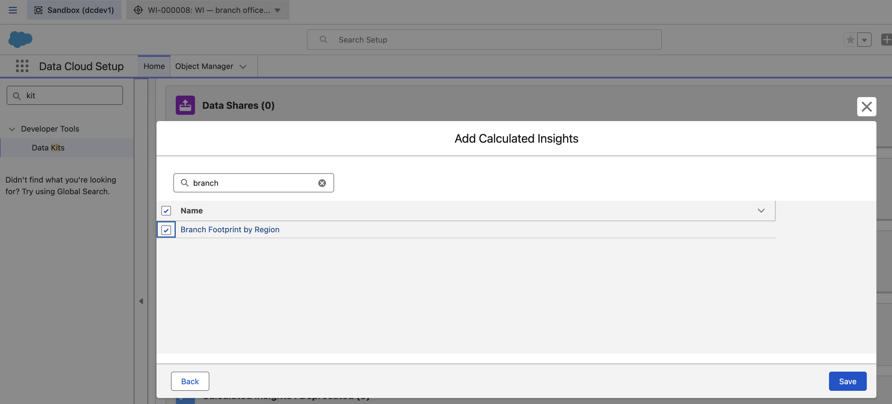). This sequence had
   never been edited, so Data 360 appended the insight as item 3 by itself: `UploadedFiles` →
   `branch_offices_bundle` → `branch_footprint_by_region`. The kit API lists the insight's
   `developerName` without `__cio`. So the bundle, already deployed in both targets, comes before the
   insight. That's the order a fresh target needs, and it's the order step 4 tests.
3. **Commit to a new work item** (WI-000009) with `./scripts/commit-datakit-to-work-item.sh`, as in
   §3e. Look at the *changed in commit* line. Trailhead warns that re-retrieving can rename template
   files.

   **Dry run (2026-10-27):** the WI-000009 branch was cut at `45da005`, the `dcstaging1` tip. The manifest now
   has 35 members. Check-only validation against `dcstaging1` passed with 37/37 components. The commit
   is small, **three files**, and no template was renamed:
   - `A` `dataCalcInsightTemplates/branch_footprint_by_region.dataCalcInsightTemplate-meta.xml`: the
     insight as a template (SQL, `default` space, `CALCULATED_METRIC`).
   - `A` `DataPackageKitObjects/branch_offices_datakit_<n>.DataPackageKitObject-meta.xml`: its kit
     membership.
   - `M` `dataPackageKitDefinitions/branch_offices_datakit…`: `deploymentOrder` gains a third entry
     (`branch_footprint_by_region`, type `DataCalcInsightTemplate`), and `versionNumber` goes from 2.0 to 3.0.

   **Real commit (2026-10-27):** the same three files went in as `201b90f`, pushed to
   `origin/WI-000009`. Lifecycle Center inspected the push as `WICL-000000017`. Its Change List matched
   the commit: 3 of the 35 kit members changed, and the other 32 were already on the branch from WI-000007/8.
   So an update to a kit commits only the delta, even though the script retrieves the whole manifest.

   In the UI, WI-000009's **Change List** shows *3 Changed Components*: `DataPackageKitObject` NEW,
   `DataCalcInsightTemplate` NEW, and `DataPackageKitDefinition` CHANGE
   (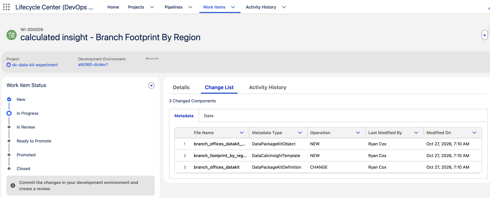). Its **Activity History** logs the
   pushed commit as a normal commit: *Commit Started*, three *Commit Component* rows, and *Commit Completed*,
   all SUCCESS (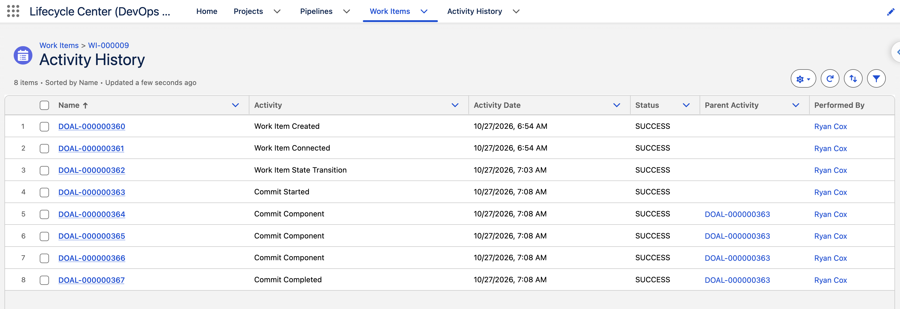). That's the same
   finalize step that fails when DX Inspector commits a kit (§3). After that the usual flow worked:
   DX Inspector's **Create Review** opened the PR, and the work item went In Review and then Ready to
   Promote (approved 14:13 UTC).
4. **Promote to Staging**, then deploy the components:
   ```bash
   ./scripts/deploy-datakit-components.sh -k branch_offices_datakit -o afd360-dcstaging1 --dry-run
   ./scripts/deploy-datakit-components.sh -k branch_offices_datakit -o afd360-dcstaging1
   ```
   The script compares each publishing-sequence item with the deployment log. It deploys only if
   something, here the CI, was never deployed. The deploy replays the **whole** sequence. Before this
   test the open question was whether redeploying the already-deployed bundle would fail and stop the
   CI. It doesn't (result below).

   **Promotion to Staging (2026-10-27, 14:15 UTC):** *Promotion completed successfully*. The Promotion
   Options for this first stage offer no Promote Now / Schedule choice, only *Only changes missing
   from Staging* (the default, used here) and the test options. Afterwards, `dcstaging1`'s kit lists the
   `CalculatedInsight` component, with the sequence 1. `UploadedFiles` → 2. `branch_offices_bundle` →
   3. `branch_footprint_by_region`. But `GET /ssot/calculated-insights/branch_footprint_by_region__cio`
   returns `ITEM_NOT_FOUND`. **So an update install behaves like the first install:** it brings the
   template and the new sequence, and creates nothing. The dry run reported the connection and the bundle as
   *deployed (log)* and the insight as **NOT DEPLOYED**.

   **Component deploy (2026-10-27, job `08PDR00000DA8Nw`): everything succeeded.** The job replayed the
   whole sequence, and all four log rows are Successful:

   | Time (UTC) | Row | Status |
   |---|---|---|
   | 14:19:49 | (kit) | Successful |
   | 14:19:51 | `UploadedFiles` | Successful (redeployed) |
   | 14:19:59 | `branch_offices_seedcsv` (bundle `branch_offices_bundle`) | Successful (**redeployed in place**) |
   | 14:20:45 | `Branch Footprint by Region` | Successful (**new**) |

   - The insight `branch_footprint_by_region__cio` exists in `dcstaging1`. It's **Active**, in
     `default`, Not Scheduled, and has **never run**
     (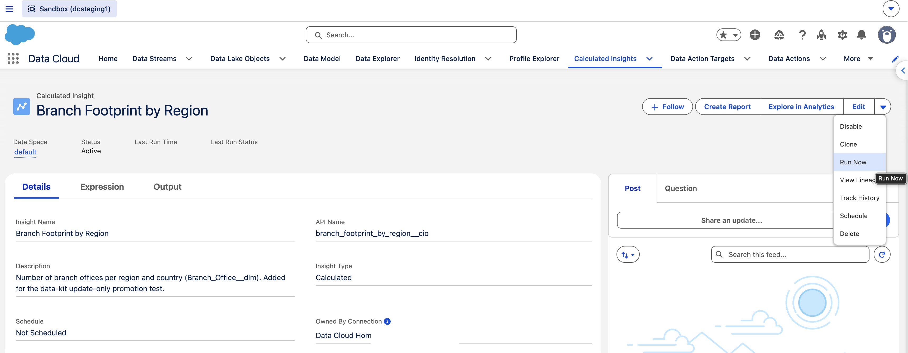). Run it once (▾ → **Run Now**).
     **Ran at 14:25 UTC: SUCCESS.** It returns 24 region × country rows totalling **50**, with the same
     per-region counts as `dcdev1` (Data Explorer / Query Editor:
     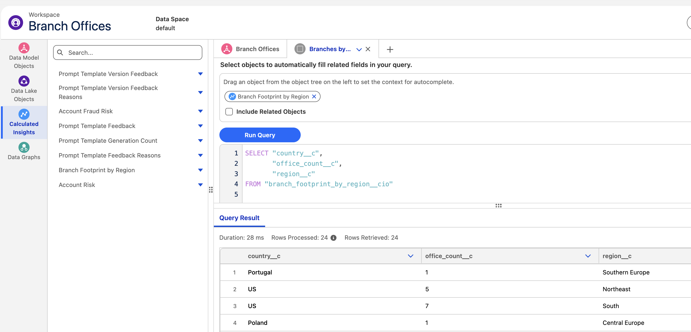). The update is verified end to end in Staging.
   - The redeploy left the data alone. The stream is still ACTIVE (modified at 14:19:56), and the DLO
     and the DMO still hold **50** rows each. No re-upload is needed.
   - **So an update to a deployed kit needs only:** commit, then promote, then run the component deploy
     again, then run the new insight. The publishing sequence needs no reordering, and you don't need a
     new kit. Trailhead's advice to *"create a new data kit"* to update deployed components wasn't
     needed for an *added* component.
   - Yesterday's *"already exists"* failure (§6 step 3 callout) came from two jobs running at the
     same time, not from redeploying.
   - The log names a calculated insight by its **label**, not its API name. `deploy-datakit-components.sh`
     now matches on both. Its first run reported a false *not deployed* for that reason, and it was fixed
     and re-checked with `--job-id 08PDR00000DA8Nw`.

5. **Promote to Production (verified, 2026-10-27).** Do the same steps in `afd360-prod`:
   - **Promote Stage** from Staging, with the default options: *Promote Now*, *Only changes missing
     from Production*, *No tests*
     (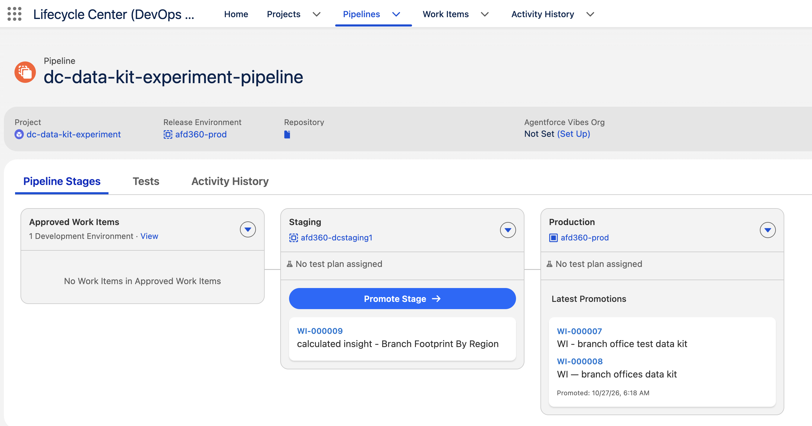,
     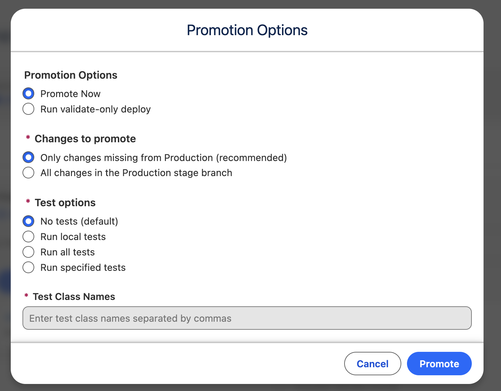).
   - **Promotion Successful** at 7:29 AM in the UI's time zone (14:29 UTC). Production's *Latest Promotions*
     now lists WI-000009 (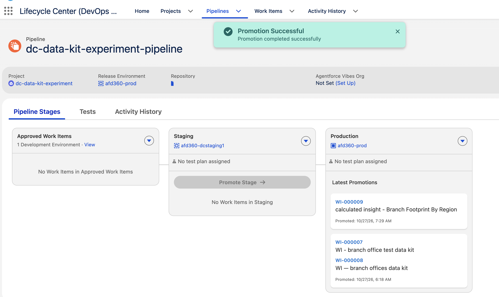).
   - **Dry run after the install.** The kit installed with the insight in its components and as item 3
     of its publishing sequence. Its deployment history still has only the first job (`08PKa00000qP9r8`,
     13:23 UTC). The stream is ACTIVE. Items 1–2 show *deployed (log)*, and item 3,
     `branch_footprint_by_region`, shows **NOT DEPLOYED**. As in Staging, the install created nothing.
   - **Baseline before the component deploy:** the DLO and the DMO each hold **50** rows.
   - **Component deploy:** job `08PKa00000qPAJM`.

     | UTC | Log row | Status |
     |---|---|---|
     | 14:32:46 | (kit) | Successful |
     | 14:32:48 | `UploadedFiles` | Successful (redeployed) |
     | 14:32:54 | `branch_offices_seedcsv` | Successful (**redeployed in place**) |
     | 14:33:07 | `Branch Footprint by Region` | Successful (**new**) |

   - **Data untouched:** the stream is still ACTIVE (modified at 14:32:52), and the DLO and the DMO
     still hold **50** rows each, the same as before the deploy. No re-upload is needed.
   - **Insight run:** `./scripts/create-calculated-insight.sh -o afd360-prod --run-only` ran at 14:36
     UTC: **SUCCESS**. It returned 24 region × country rows totalling **50**, matching `dcdev1` and
     Staging. In the UI the insight showed Active, created 7:33 AM, never run
     (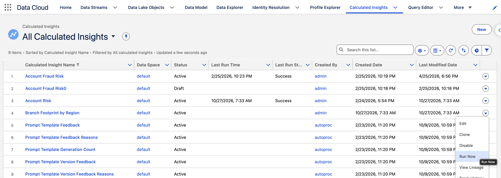). The Query Editor returns the same 24 rows
     (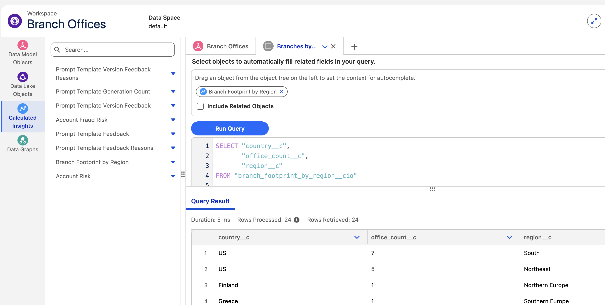). `Account Risk`, a streaming insight that
     isn't in the kit, also shows 7:33 AM. That's its own streaming refresh (last run 14:33:10 UTC), not
     the kit touching it. `--run-only` was added for target orgs. It never creates the insight, because one created
     by hand isn't kit-owned and no kit could update it later.
   - **The update is verified end to end in Production too.** An added component moves through
     the same steps in every stage: commit the delta, promote (which only installs), run the component
     deploy (existing items redeploy in place with their data intact), then run the new insight once.

---

Optional automation of steps 1–6 → `40-mcp-optional.md`.
