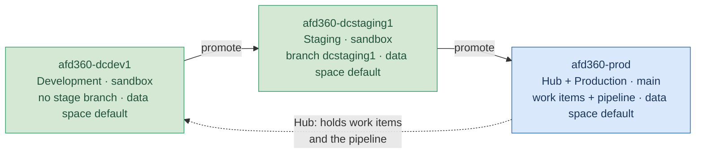
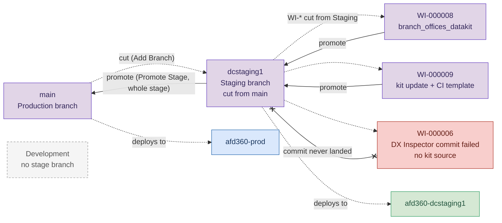
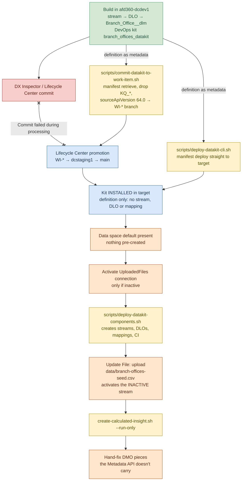

# Architecture — reference

This is a **reference**, not a numbered runbook step, like [orgs.md](orgs.md). It shows how the
pipeline is put together: which orgs and branches exist and how a Data Cloud data kit moves through
them. Org aliases are defined in [orgs.md](orgs.md). The step-by-step procedure is in
[30-promote.md](30-promote.md).

## Orgs and stages

There are three orgs and three stages. `afd360-prod` is **one org with two roles**: the Lifecycle
Center Hub that holds the work items and the pipeline, and the final Production stage.
All three were verified end to end on 2026-10-27.

## Branches

Branches map right to left. `main` belongs to Production and `dcstaging1`, cut from `main`, belongs
to Staging. Development has no stage branch. `WI-00000N` branches are cut from the Staging branch
and promoted into `dcstaging1`. **Promote Stage** then merges the whole stage into `main`. Each
merge deploys to its stage's org. `WI-000006` (red) was the DX Inspector commit attempt: it never
received a commit and was never merged. `WI-000008` carried the kit and `WI-000009` an update to it
(an added calculated insight), both committed with the script.

## How a data kit moves

Only the kit **definition** crosses, through the commit script and promotion or through the direct
CLI deploy. The DX Inspector commit fails at finalize and is not a working path. Promotion only
**installs** the kit. The runtime wiring is then redone in each target (orange = UI or hand step).

## What moves vs. what you redo

**Moves as metadata** (commit script → `WI-*` → promotion, or `deploy-datakit-cli.sh`), taken from
the kit manifest (`GET /ssot/datakit/<kit>/manifest`):

- Kit definition (`DataPackageKitDefinition`) and its `DataPackageKitObject` publishing-sequence
  entries
- Templates: `DataStreamTemplate`, `DataKitObjectTemplate`, `DataKitObjectDependency`,
  `DataSourceBundleDefinition`, `DataSourceObject`, `MktDataSource` (UploadedFiles)
- `Branch_Office__dlm` DMO object and fields, minus `KQ_*`
- DLO → DMO `DataSrcDataModelFieldMap` source-target maps (9 for this kit)
- `DataCalcInsightTemplate` `branch_footprint_by_region` (added by the WI-000009 update)

**Redone in each target:**

- Data space: must exist. `default` is used everywhere, so nothing is pre-created.
- File connection (UploadedFiles): activate it only if it's inactive. It was inactive in
  dcstaging1 and already active in prod.
- Component deploy: `deploy-datakit-components.sh` (`POST /ssot/data-kits/<kit>?asyncMode=true`)
  creates the streams, DLOs, mappings and CI. Installing alone creates none of them.
- The data stream arrives INACTIVE. Update File, uploading `data/branch-offices-seed.csv`,
  activates it (UI only).
- Strip the `KQ_*` Key Qualifier field before every deploy or commit (both kit scripts do this).
- Raise `sourceApiVersion` from 62.0 to 64.0 on the WI branch (the commit script does this; the
  scripts default `--api-version` to 64.0).
- Run the calculated insight in the target with `create-calculated-insight.sh --run-only`. Never
  hand-create it.
- Hand-fix any DMO pieces the Metadata API doesn't carry ([30-promote.md](30-promote.md) §7).

**Known broken:**

- The DX Inspector / Lifecycle Center commit of data-kit metadata. Components stage, then
  `COMMIT_COMPLETED` fails with *Commit failed during processing*, and the branch never moves.
  See [30-promote.md](30-promote.md) §3.
- Two `deploy-datakit-components.sh` runs at once fail on a duplicate DLO. That is a race, not a
  redeploy failure.
- Deploying kit source at `sourceApiVersion` 62.0 fails.

## Where things live

- **Registry:** [`config/environments.json`](../config/environments.json) holds aliases, roles,
  stages, branches and data spaces. No script reads it. Scripts take aliases as flags.
- **Scripts:** [`scripts/`](../scripts/README.md). The kit path is `commit-datakit-to-work-item.sh`,
  `deploy-datakit-cli.sh`, `deploy-datakit-components.sh` and `create-calculated-insight.sh`. Setup
  and checks are `setup-devops-center-hub.sh`, `verify-datacloud-prereqs.sh`,
  `watch-datakit-deploy.sh` and `cancel-work-item.sh`. CLI scratch files go in `tmp-cli-validation/`.
- **Runbook:** `plan/00` → `10` → `20` → [`30-promote.md`](30-promote.md) → `40` / `50`. Org aliases
  are in [orgs.md](orgs.md).
- **Kit source:** written only to `WI-*` branches, by `commit-datakit-to-work-item.sh` in a worktree
  under `tmp-cli-validation/wi-commit/<WI>/`. Promotion merges it into `dcstaging1` and `main`. It is
  never hand-authored into `force-app/`. A copy of the promoted kit source is in
  [`examples/`](../examples/README.md).
- **Seed data:** `data/branch-offices-seed.csv`, uploaded by hand in each org (Update File).
